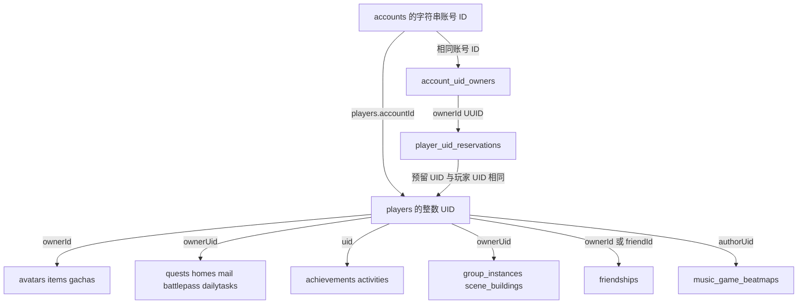

# 账号与存档数据模型

本字典用于定位一项进度究竟保存在哪里、依赖哪些身份和恢复记录。与[系统接手指南](ACCOUNT_AND_SAVE_SYSTEM.md)、[运维与验证手册](ACCOUNT_AND_SAVE_OPERATIONS.md)配套使用。核对日期为 2026-10-21，源码基线为 `63f0fa7923ddd68c9c62e0dfb8cbcbc756d07371`。

下文示例使用虚构编号和 UUID，仅展示关系；省略了实际建档必需字段，不能作为可导入存档。

## 数据分层

| 层次 | 数据位置 | 作用 |
| --- | --- | --- |
| 身份与认证 | 账号数据库 `accounts`、`account_uid_owners` | 用户名、密码策略、令牌、权限、封禁、稳定归属 |
| 玩家核心 | 游戏数据库 `players` | 个人资料、属性、位置、解锁、队伍、抽卡进度及部分业务凭证 |
| 玩家分表 | 游戏数据库中的角色、物品、任务、家园、活动等集合 | 数量较多或由独立管理器加载、保存的内容 |
| 编号与归属 | 游戏库 `counters`、`player_uid_reservations`、`mailCounters` | 原子编号、UID 占有关系、邮件编号 |
| 运行数据 | `folderStructure.data` 指向的目录，本机约定为 `local/data/` | 卡池、商城、公告等服务数据和覆盖配置 |
| 静态资源 | `resources/`、JAR 内资源及相应覆盖 | 定义 ID 的含义、任务脚本、角色和装备基础数据 |
| 内存运行状态 | 会话、世界、场景实体、队列、Guard、各 transient 管理器 | 运行中重建或暂存的状态，不直接等于持久存档 |

`mongodata/` 是 MongoDB 的物理数据目录，包含数据库文件；它不是一组可直接编辑的玩家 JSON。`local/data/` 也不是 MongoDB 的替代位置。二者需要分别备份。

## 账号到存档的关系



同样叫 `ownerId` 的字段不总是同一种类型：UID 元数据里是账号归属 UUID；角色和物品里是玩家整数 UID。维护脚本必须按集合解释。

关系示例：

```text
// 关系示意，不能直接导入。账号库与游戏库可能不同。
accounts:                { _id: "12001", reservedPlayerId: 23001 }
account_uid_owners:      { _id: "12001", ownerId: "11111111-1111-4111-8111-111111111111" }
player_uid_reservations: { _id: 23001, ownerId: "11111111-1111-4111-8111-111111111111",
                           operationId: "22222222-2222-4222-8222-222222222222", kind: "account" }
players:                 { _id: 23001, accountId: "12001" }
avatars:                 { _id: ObjectId("000000000000000000000001"), ownerId: 23001,
                           avatarId: 10000007 }
items:                   { _id: ObjectId("000000000000000000000002"), ownerId: 23001,
                           itemId: 201, count: 20 }
```

即使账号 ID 和玩家 UID 碰巧显示相同数字，也不能合并两个概念。变更 UID 会影响多集合和业务凭证，不是只修改 `players._id`。

## 持久集合字典

“Guard”表示内置写入入口经过整份文档版本保护；“普通”表示没有这四类专用 Guard，业务自身仍可能有同步保存、预留或去重机制。集合按需创建，尚未用过的功能没有集合不必然是故障。

| 集合 | 数据库与主键 | 关联字段 | 内容和写入性质 |
| --- | --- | --- | --- |
| `accounts` | 账号库；字符串 `_id` | `reservedPlayerId` 是可选预留 UID | 凭据、权限、封禁、语言；Account Guard |
| `account_uid_owners` | 账号库；字符串账号 `_id` | `ownerId` 为 UUID | 稳定账号归属；原生确认插入和唯一约束，删除账号时保留 |
| `counters` | 游戏库；字符串 `_id` | `_id` 通常为 `Account`、`Player` | `count` 原子编号；兼容合法旧 int32/int64，写入推进为 long |
| `player_uid_reservations` | 游戏库；整数 UID `_id` | `ownerId` UUID、`operationId`、`kind` | `account` 或 `anonymous` 持久预留，删除账号时保留 |
| `players` | 游戏库；int UID `_id` | 字符串 `accountId` | 核心档案与嵌入进度；Player Guard |
| `avatars` | 游戏库；ObjectId `_id` | int `ownerId` | 角色等级、天赋、命座、好感、生命／能量等；普通保存 |
| `items` | 游戏库；ObjectId `_id` | int `ownerId`、`itemId` | 材料、武器、圣遗物、家具等库存实例；Item Guard 与删除记录 |
| `quests` | 游戏库；ObjectId `_id` | int `ownerUid`、`parentQuestId` | 父任务、子任务状态、变量、计时及任务 suite；普通保存 |
| `homes` | 游戏库；Java `String id` 映射 `_id` | long `ownerUid` | 家园布局、等级、货币、制作与凭证；普通保存 |
| `activities` | 游戏库；Java String ID，Guard 兼容已有 String/ObjectId BSON `_id` | int `uid`、`activityId`、`scheduleId` | 活动 watcher、货币、detail 及恢复凭证；Activity Guard |
| `achievements` | 游戏库；ObjectId `_id` | int `uid` | 成就明细、完成数、目标领奖列表；普通保存 |
| `battlepass` | 游戏库；ObjectId `_id` | int `ownerUid` | 战令排期、等级、经验、任务及领取状态；普通保存 |
| `dailytasks` | 游戏库；ObjectId `_id` | int `ownerUid` | 委托任务、地区、当天额度和总奖励状态；普通保存 |
| `friendships` | 游戏库；ObjectId `_id` | int `ownerId`、`friendId`、`askerId` | 好友／申请关系和资料快照；普通保存，删除账号需清双向引用 |
| `mail` | 游戏库；ObjectId `_id` | int `ownerUid`、`mailId` | 邮件内容、附件、领取预留、投递去重；普通保存及业务确认 |
| `mailCounters` | 游戏库；`_id="sequence"` | `value` | 独立的全局邮件编号；原子递增，不是邮箱中的数组下标 |
| `gachas` | 游戏库；ObjectId `_id` | int `ownerId`、`gachaType` | 抽卡历史 `itemID`、`transactionDate`；不等于抽卡保底进度 |
| `group_instances` | 游戏库；ObjectId `_id` | int `ownerUid`、`groupId` | 房主所属场景 group 进度，走 group 队列；普通保存 |
| `scene_buildings` | 游戏库；UUID 字符串 `_id` | int `ownerUid`、`sceneId` | GM 持久建造的物件与位置；专用 Store 同步确认写入 |
| `music_game_beatmaps` | 游戏库；long `musicShareId` 映射 `_id` | int `authorUid` | 自制谱面及分享信息；存在存储模型不代表所有上传协议均已实现 |

`open_world_spawns` 还出现在账号删除的兼容清理表中，使用 `ownerUid`。当前主源码未检出对应的生产写入实体，不应将它描述为当前已启用的刷怪存档系统；迁移旧库时仍应保留并核对其用途。

映射依据：[game 下实体](../src/main/java/emu/grasscutter/game)、[DatabaseHelper](../src/main/java/emu/grasscutter/database/DatabaseHelper.java)、[PlayerUidAllocator](../src/main/java/emu/grasscutter/database/PlayerUidAllocator.java)、[AccountDeletionService](../src/main/java/emu/grasscutter/database/AccountDeletionService.java)。仅有 `@Entity` 而没有独立集合名的类，很多用于嵌入文档，不能按 Java 类数推算集合数。

## Account 字段

| 字段 | 含义与维护要点 |
| --- | --- |
| `id`／BSON `_id` | 字符串账号编号；已绑定对象不能修改身份后保存 |
| `username` | 登录名称，唯一索引；不要对旧账号自行做大小写归一 |
| `password` | 散列或历史明文；不应输出到诊断报告 |
| `passwordRequired` | 密码重置后置 true，限制宽松认证入口；不等同于全局 `EXPERIMENTAL_RealPassword` |
| `sessionKey`、`token` | 两类登录凭据；重置时一并撤销；恢复旧备份也会恢复旧凭据内容 |
| `reservedPlayerId` | 创建账号时预留 UID，默认 0；不能用它替代实际玩家关联查询 |
| `permissions` | 账号权限列表，实际判断还合并全局默认权限；旧文档缺少此字段时 PreLoad 会给予历史兼容的 `*` |
| `locale`、`email` | 账号语言与邮箱展示；没有邮箱时由用户名和配置后缀构造显示值 |
| `isBanned`、`banReason`、`banStartTime`、`banEndTime` | 封禁信息，时间按 Unix 秒；`isBanActive()` 是只读判断，`isBanned()` 的过期清理会调用保存 |
| `saveStamp` | 本副本的写入版本及 UUID；与密码散列、登录 token 不是同一概念 |

`Account.saveGuard` 不持久化。通过 Gson、手工构造或复制字段得到的 Account，不能当成通过正规加载／创建确认过的可保存对象。

## Player 内嵌进度

[Player.java](../src/main/java/emu/grasscutter/game/player/Player.java) 的体积较大，按下面的业务域定位比逐字段浏览更直接。字段名称保留源码拼写，例如 `unlockedRecipies`。

| 业务域 | 主要字段 | 还要一起检查 |
| --- | --- | --- |
| 资料与展示 | `nickname`、`signature`、`headImage`、`birthday`、`profileCosmetics`、`playerProfile`、展示角色和名片列表 | 好友文档里的 profile 是快照，不是玩家本体 |
| 玩家数值 | `properties` | 键来自 `PlayerProperty` 数字 ID，含等级、经验、货币、树脂等；不能把所有货币当作 `items` |
| 位置与返回点 | `sceneId`、`regionId`、`position`、`rotation`、`prevPos`、`prevScene`、`prevPosForHome`、`dungeonReturnLocation` | 登录会校正家园／副本返回位置，不一定原样使用最后坐标 |
| 世界解锁 | `openStates`、`sceneTags`、`unlockedSceneAreas`、`unlockedScenePoints`、`forceLockedScenePoints`、`mapMarks` | 资源中的条件、场景 group 和任务进度 |
| 任务辅助 | `questGlobalVariables`、`activeQuestTimers`、`forcedFinishedQuests`、`playedFirstLoginCutscene` | 真正父子任务在 `quests`；强制完成通知不等于完整任务数据 |
| 角色与外观解锁 | `mainCharacterId`、`mainCharacterElement`、`nameCardList`、`flyCloakList`、`costumeList`、`traceEffectList`、`weaponSkinList` | 实际角色成长在 `avatars`，装备实例在 `items` |
| 队伍与深渊 | `teamManager`、`towerData` | 临时队伍、场景能力与借用角色有独立生命周期；参考队伍持久化专题 |
| 图鉴与探索 | `codex`、`playerProgress`、`collectionRecordStore` | 资源 ID、图鉴旧档迁移和采集状态各自规则 |
| 抽卡与购买 | `gachaInfo`、`shopLimit`、`freeProductPurchases`、`freePurchaseReceipts` | 抽卡历史在 `gachas`；卡池和商品定义在运行数据／资源 |
| 学习解锁 | `unlockedForgingBlueprints`、`unlockedCombines`、`unlockedRecipies`、`unlockedFurniture`、`unlockedFurnitureSuite` | 学习书扣费记录及特定家园解锁 |
| 制作与派遣 | `activeForges`、`activeCookCompounds`、`expeditionInfo`、`pendingCook`、`pendingCombine`、`pendingStrongbox` | 内嵌记录中的付款、发放、退款阶段；原库存实例 |
| 神像和世界资源 | `cityInfoData`、`springLastUsed`、`phlogistonValue` | 神像 `pendingOffer`、供奉成本及资源表 |
| 物品与小道具 | `pendingItemUse`、`itemUseCooldowns`、`lunchBoxFood`、`widgetId`、`widgetPetId` | 物品实例、冷却组及运行时 WidgetManager |
| 圣遗物定向与重塑 | `artifactTransmuterData` | pending 计划、周期、定向次数、候选与实际圣遗物实例 |
| TPS | `tpsLoadout`、`tpsLoadoutInitialized`、`tpsAmmunition`、`tpsMagazineAmmunition`、`pendingTpsSupply`、`lastTpsReport` | 角色 TPS 武器、物品配件及场景临时状态 |
| 音游与千星奇域 | `musicGameBookThemes`、`musicGameBookRecords`、`musicGameBookSettings`、`musicGameBookMods`、`beyondProgress`、`beyondCloset` | `music_game_beatmaps` 是另一个存储模型，不应混同 |
| 周期与奖励 | `lastDailyReset`、`weeklyBossChestNum`、`rewardedLevels`、`homeRewardedLevels`、月卡日期与领取集合、`lastBirthdayMailYear` | 每日任务、战令、活动也有独立周期字段 |
| 管理开关 | `inGodMode`、`unlimitedStamina` | 这些布尔字段可随玩家持久化，不全是运行时设置 |

### 哪些成员不随 Player 整份保存

`account`、`session`、`world`、`scene`、`avatars`、`inventory`、`friendsList`、`mailHandler`、`questManager`、`activityManager`、`home` 等为 transient／`@Transient`。其中有些拥有独立持久集合，有些只是管理器，不代表数据丢失。

实体列表、网络回调、攻击队列、会话 GUID 计数、锁、待传送任务、场景加载状态等属于运行时状态。`teamManager` 则包含可持久成员，不能因为类名以 Manager 结尾就整体当作临时对象。

字段只被序列化还不够：修改时必须触发正确保存入口，读回后还要完成资源绑定和业务校验。

## 角色与物品

### 角色档案

[Avatar](../src/main/java/emu/grasscutter/game/avatar/Avatar.java) 保存 `ownerId`、`avatarId`、等级／经验／突破、`skillDepotId`、基础天赋等级、命座和固有天赋、好感、外观、试用来源及当前生命／能量等。

最终战斗属性、队伍临时天赋加成、装备映射与 guid 在内存重建。加载生命／能量时先保留原快照，装备与属性重算后再按规则应用，避免先按错误上限夹掉数值。当前特殊能量与旧档兼容见[角色状态持久化](AVATAR_VITALS_PERSISTENCE_2026-10-16.md)。

不要把一次战斗中算出的最终属性写回基础天赋或角色配置，也不要把临时场景角色按正式自有角色保存。

### 物品实例和删除记录

[GameItem](../src/main/java/emu/grasscutter/game/inventory/GameItem.java) 同时服务材料堆叠、武器、圣遗物等类型。共同字段包括 `_id`、`ownerId`、`itemId`、`count`、`saveStamp`、`deleted`；装备还有等级、经验、突破、精炼、词条、锁定、装备归属及 TPS 配件等字段。

`ItemSaveGuard` 的条件包含实例 ID、所属玩家、物品种类、旧版本和删除状态。同一种 `itemId` 的两件装备不能互相替代。定向圣遗物和重塑候选还保留具体词条与原物品标识，修复时不能仅按总数量对账。

| 状态 | 存储表现 | 处理规则 |
| --- | --- | --- |
| 有效库存 | `deleted != true` 且 `count > 0` | 正常加载 |
| 已消耗／已删除 | `deleted=true`、`count=0`，ID 与版本保留 | 不加载到库存；保留以阻止旧写入复活 |
| 异常组合 | 如 `deleted=true` 但 `count>0` | 先保留原文档与日志，核查原操作，不按“数量大于零”强行恢复 |
| 受控退款 | 原实例与凭证匹配，使用专用恢复流程 | 可能记录 `foodRefundOperationId` |
| 学习扣费 | 原实例与学习计划匹配 | 记录 `recipeUseOperationId`，供重试核对 |

消耗记录没有自动过期清理承诺。备份筛选不能只导出 `count>0` 的库存，否则会丢失防重放信息。

## 任务 世界 家园 活动

| 模块 | 保存内容 | 关键边界 |
| --- | --- | --- |
| `quests` | `childQuests`、`parentQuestId`、状态、`questVars`、`timeVar`、对话和 `questGroupSuites` | 需要重新绑定资源定义；玩家全局变量还在 `players` |
| `group_instances` | `targetSuiteId`、`activeSuiteId`、`deadEntities`、`scriptDestroyedGadgets`、机关状态、Lua 变量及刷新时间 | `ownerUid` 是房主；`persistent=false` 的临时副本实例不保存；活动回合可重置而 watcher 进度保留 |
| `scene_buildings` | UUID、主人、场景、物件 ID、位置与旋转 | 场景 entity ID 是临时的；持久建造与临时放置不同 |
| `homes` | 家园等级、经验、累积货币／好感、布局、家具队列、协助与解锁 | 多项制作凭证内嵌；家园文档不是 `players.home` 子文档 |
| `activities` | 活动及排期、`watcherInfoMap`、`activityCoins`、JSON 字符串 `detail` | Guard 还核对原排期；detail 各活动含义不同，不能当成统一 JSON schema |

活动数据按 `uid + activityId` 查询当前文档，`scheduleId` 决定该活动周期语义。Guard 可以防止旧副本覆盖，但不等价于为所有活动建立了业务复合唯一索引。恢复时先检查是否存在同玩家同活动的重复文档，不能任取一份覆盖另一份。

`PlayerActivityData.save()` 对特定历史活动及活动货币使用同步路径，其余可异步。待核对货币或 watcher 奖励可能阻止普通保存，以防绕过恢复流程。

## 恢复凭证分布

下表是定位入口，不是统一阶段编码表。数字 `1`、`2` 在不同业务含义不同，应读对应 Receipt／Transaction 类和专题。

| 凭证位置 | 保存的业务意图 | 首选说明 |
| --- | --- | --- |
| `players.pendingItemUse`，物品上的使用／退款操作 ID | 食物效果、库存付款／退款、配方学习 | [物品恢复](ITEM_USE_RECOVERY_2026-10-15.md)、[学习书](LEARNING_BOOK_PERSISTENCE_2026-10-17.md) |
| `players.pendingCook`、`pendingCombine`、`pendingStrongbox` | 烹饪、合成、还圣奥迹的成本与产物 | [烹饪发放](COOK_DELIVERY_2026-10-13.md)、[合成确认](COMBINE_CONFIRMATION_2026-10-13.md)、[还圣确认](STRONGBOX_CONFIRMATION_2026-10-13.md) |
| `players.activeForges[]` | `startState`、`outputState`、`refundState`、付款和冻结产物 | [锻造发放](FORGE_OUTPUT_DELIVERY_2026-10-13.md)、[退款](FORGE_REFUND_DELIVERY_2026-10-13.md) |
| `players.activeCookCompounds` | 加工队列、预留领取数量和 `claimState` | [加工发放](COMPOUND_QUEUE_DELIVERY_2026-10-13.md) |
| `players.expeditionInfo` | 派遣状态、天赋快照和 `rewardState` | [派遣领取](EXPEDITION_CLAIMS_2026-10-13.md) |
| `players.cityInfoData.*.pendingOffer` | 神像供奉的成本、等级和奖励计划 | [供奉恢复](STATUE_OFFERING_RECOVERY_2026-10-15.md) |
| `players.artifactTransmuterData.pending` 与 `reshapeCandidates` | 定向、萃取或重塑的材料与候选 | [定向恢复](ARTIFACT_TRANSMUTER_RECOVERY_2026-10-15.md)、[重塑恢复](ARTIFACT_RESHAPE_RECOVERY_2026-10-15.md) |
| `players.pendingTpsSupply`、`lastTpsReport` | 弹药补给与消耗报告的前后状态 | [TPS 保存保护](TPS_RECOVERY_SAVE_FENCE_2026-10-16.md) |
| `homes.pendingFurnitureStart/Take/Cancel/Bulk` | 家具开始、领取、取消和批量操作 | [家具恢复](FURNITURE_QUEUED_RECOVERY_2026-10-13.md)、[批量恢复](FURNITURE_BULK_RESUME_2026-10-13.md) |
| `activities.pendingCoinOperation/lastCoinOperation` | 活动货币余额变化 | [货币恢复](ACTIVITY_COIN_RECOVERY_2026-10-17.md) |
| `activities.pendingWatcherReward/lastWatcherReward` | watcher 整批领奖计划及结果 | [活动任务领奖](ACTIVITY_WATCHER_REWARDS_2026-10-17.md) |
| `mail.claimInProgress`、`deliveryKey`、`deliveryDigest` | 邮件附件领取预留与投递去重 | [邮件协议](protocol-mail-notices-7.1.md)及 [MailHandler](../src/main/java/emu/grasscutter/game/mail/MailHandler.java) |
| `players.freePurchaseReceipts` 等购买记录 | 特定商品领取／购买去重 | [商城](protocol-store-7.1.md)及具体商品处理代码 |

不要假设有一张统一的交易日志集合，也不要凭证一律自动重放。部分故障需要人工核对，部分副作用不能从“物品总数正确”证明执行了一次。

## 索引与唯一性

| 索引来源 | 当前关键定义 | 维护含义 |
| --- | --- | --- |
| Account 映射及创建服务 | `username` 唯一 | 同名创建靠数据库裁决；已有重复值会阻止建立唯一索引 |
| 账号创建服务按需建立 | `reservedPlayerId` 正数部分唯一索引 | 0 不参与；不能改成包含所有默认 0 的普通唯一索引 |
| Player 映射 | `accountId` 唯一 | 一个账号在该游戏库应只有一个玩家核心档案 |
| UID 分配器按需建立 | 两份归属集合的 `ownerId` 唯一 | 并发同账号预留汇合；不能随意删除 |
| GameItem 映射 | `ownerId` 与 `ownerId,count` 复合索引 | 方便有效库存查询；查询还需排除 deleted |
| GameHome 与 DailyTaskManager 映射 | `ownerUid` 唯一 | 对应玩家的一份主记录 |
| Mail 映射 | `deliveryKey` 唯一且 sparse | 缺此字段的旧邮件可并存；有键时支持投递去重 |
| 其他 owner 字段索引 | Avatar、Friendship、Gacha、Quest、BattlePass、Group、Building 等 | 普通索引不提供业务复合唯一性 |

索引是行为的一部分，备份与恢复不能只关注文档数量。启动时 `ensureIndexes` 的错误码 85 分支可能先删除索引；应在恢复前保存索引定义，并在恢复后确认业务按需创建的原生索引没有遗漏。

## 类型和兼容规则

- `saveStamp.revision` 要保留 BSON int64；stamp 中只有 revision 和 UUID token。它表示并发版本，不表示数据库 schema 版本。
- 旧档缺少 stamp 可在首次保存时晋升；不能手工给全库补 `revision=1` 或复用一个 UUID。
- String、ObjectId、int、long、Date、JSON 字符串各有不同含义。活动 Guard 特别保留读取到的原 BSON ID 类型，不要在导出／导入时统一转字符串。
- 旧账号缺 `permissions`、旧图鉴格式、角色特殊能量、任务资源重绑定、家园旧布局等都有各自兼容逻辑。普通读取也可能触发业务修复；损坏审计优先看原始文档。
- 时间字段没有统一单位：账号封禁和邮件时间使用秒；`itemUseCooldowns` 比较毫秒；抽卡历史为 Date；每日任务有日历日标识；`playerGameTime` 是游戏时间。改动前跟踪对应计算代码。
- 运行时对象、冻结的未确认写入和数据库业务凭证分属三种生命周期。保存 Player 不会把当前所有 Java 对象一起保存，也不会替代旁表写入。

## 新增存档字段或集合时的检查

1. 明确归属是账号、玩家、房主、活动排期还是运行会话；选择正确 ID 类型。
2. 决定字段放入现有文档还是独立集合；同时明确加载、绑定、变更、保存和删除入口。
3. 定义缺字段、null、空集合和旧值的兼容语义；避免在普通查询中执行破坏性迁移。
4. 确定是否需要版本条件、同步确认、业务凭证和原实例核对；不要仅因方法名叫 `saveSync` 就假定有事务。
5. 新集合同步更新账号删除清单、备份范围、索引说明和测试夹具。
6. 用真实 BSON 冷读验证。测试必须比较数据库结果，并覆盖旧副本、确认丢失、重复请求和重连后的处理。
