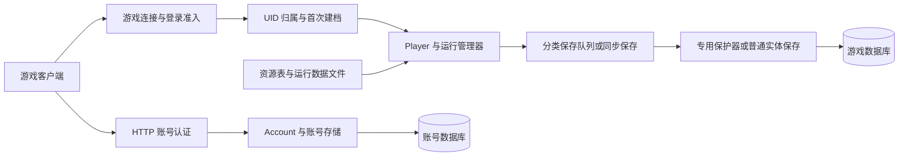
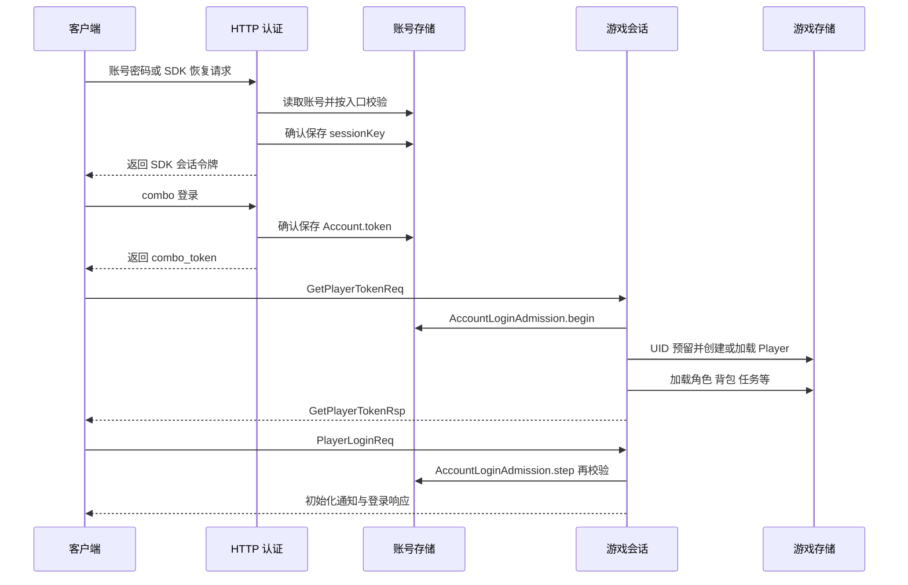
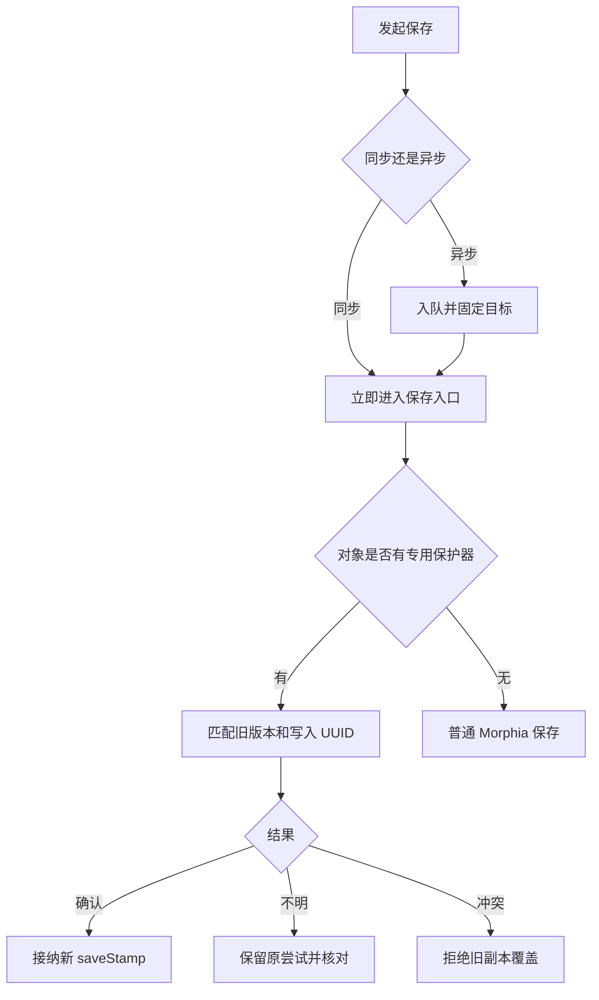

# 账号与存档系统接手指南

本项目的账号负责登录身份、凭据与权限；玩家存档负责游戏进度。两者通过账号 ID 和玩家 UID 关联，但保存位置、保存时机和并发保护并不相同。完整存档由多个 MongoDB 集合及运行数据文件共同组成，单独复制 `players` 集合无法完整恢复一个玩家。

适用基线：2026-10-21，源码提交 `63f0fa7923ddd68c9c62e0dfb8cbcbc756d07371`，LunaGC 7.1.0。后续行为变化应同时更新本指南和相应专题文档。本文依据内置实现；插件可以替换认证系统或玩家类，需要另行检查。

配套资料：

- [数据模型与集合字典](ACCOUNT_AND_SAVE_DATA_MODEL.md)：字段、关联、索引、保存范围与恢复凭证。
- [运维排障与开发验证](ACCOUNT_AND_SAVE_OPERATIONS.md)：备份、恢复、只读检查、故障定位、测试及交付要求。
- [本机约定](../AGENTS.md)和[运行入口](../LOCAL-RUN.txt)：Windows 便携部署的操作依据。

阅读导航：[接手要点](#ai-接手时先掌握的事实) · [数据库路由](#系统组成和数据库路由) · [身份与编号](#身份与编号) · [登录与认证](#登录与认证链路) · [加载和保存](#玩家加载和保存生命周期) · [写入机制](#数据库写入机制) · [经济恢复](#经济操作和故障恢复) · [分离服务](#分离服务的额外约束) · [当前边界](#当前边界与后续核查重点) · [源码导航](#主要源码导航)。

## AI 接手时先掌握的事实

1. `Account.id` 是字符串账号 ID；`Player.id` 是整数玩家 UID；`Avatar.avatarId` 是角色配置 ID。三者不能互换。
2. `accounts` 不包含背包与任务进度；`players` 也不内嵌全部角色、物品、邮件、任务、家园和活动记录。
3. `save()` 通常只是提交异步保存。需要立即确认经济结果或令牌有效性时，必须使用对应的同步业务入口。
4. `saveStamp` 是并发写入版本和写入身份，不是存档格式版本，也不是历史备份。
5. `Account`、`Player`、`GameItem`、`PlayerActivityData` 有专用保存保护器；其他实体不能据此假定也有版本保护。
6. `pending...`、领取标记和物品删除记录保存着故障恢复依据。直接清空可能造成重复发奖、漏发或物品复活。
7. UID 归属记录和计数器必须保留。账号删除不释放 UID，也不回退编号。
8. `Stop-GS.cmd` 正常停止游戏服务，但 MongoDB 仍在运行。此时不能把普通目录复制当成已验证的数据库冷备。
9. 健康接口正常只代表运行状况满足其检查条件，不证明全部存档成功、数据库可写或游戏玩法正常。
10. 本机以便携方式运行。历史专题里的 Docker 容器、进程号和 JAR 哈希是当批记录，不能用于判断当前运行版本。

建议阅读顺序：本节 → 登录链路 → 保存机制 → 数据模型 → 运维文档中的对应故障与测试。修改前再进入具体源码和专题说明。

## 系统组成和数据库路由

数据库映射由 [DatabaseManager](../src/main/java/emu/grasscutter/database/DatabaseManager.java) 决定，配置定义在 [ConfigContainer.Database](../src/main/java/emu/grasscutter/config/ConfigContainer.java)。配置字段 `collection` 实际传给 `Morphia.createDatastore` 作为**数据库名称**，不要把它误认为单个 MongoDB 集合名。

| 运行模式 | 游戏数据 | 账号来源及保存 | 主要注意点 |
| --- | --- | --- | --- |
| `HYBRID` | `databaseInfo.game` | 同一 game Datastore | HTTP 与游戏服务在同一进程，账号与游戏集合可在同一数据库 |
| `DISPATCH_ONLY` | 仍初始化 game Datastore | `databaseInfo.server` 的账号 Datastore | 账号编号仍沿用游戏库 `counters.Account` |
| `GAME_ONLY` | 本机配置的 game Datastore | 登录、敏感查询及远端保存通过已认证 Dispatch 连接访问账号服 | 本地账号 Datastore 还用于映射与来源检查，不应把同 ID 的本地文档当成远端权威账号 |

本机配置在本次核对时为 `HYBRID`、`LUNAGC_RUNTIME=portable`。启动脚本默认把本机游戏库与账号库配置成同一个数据库；真正路由仍以运行模式和当前配置为准。复制数据库前必须记录这两份配置的对应关系。

Morphia 使用 `storeEmpties(true)`、`storeNulls(false)`。空集合可持久化，null 字段通常省略；旧文档缺字段不能一律按损坏处理。存档中的资源 ID 依赖当前 `resources/` 和运行数据解释，换错资源可能表现为“读档丢失”，实际数据仍在库中。

## 身份与编号

| 名称 | 类型与例子 | 用途 |
| --- | --- | --- |
| 账号 ID | `Account.id`，字符串，例如 `"12001"` | HTTP SDK 中的 uid、aid、mid/open_id 等账号身份；`players.accountId` 引用它 |
| 玩家 UID | `Player.id`，整数，例如 `23001` | 游戏内玩家身份，其他玩家集合的 owner 字段引用它 |
| 预留玩家 UID | `accounts.reservedPlayerId` | 创建账号时指定的候选玩家编号；默认 0，不表示已经存在玩家档案 |
| 账号归属 UUID | `account_uid_owners.ownerId` | 区分稳定账号身份，防止只靠相同字符串账号 ID 接管旧角色 |
| 预留操作 UUID | `player_uid_reservations.operationId` | 标识一次持久 UID 归属操作 |
| 角色或物品文档 ID | MongoDB `ObjectId` | 持久实例身份，恢复和核对时必须保留 |
| 角色或物品配置 ID | `avatarId`、`itemId` | 指向资源中的种类；多件同类装备可有相同 `itemId` |
| 运行时 GUID | Java `long` | 角色与物品绑定玩家时生成，当前公式是 `(UID << 32) + nextGuid`；属于运行对象引用 |

`nextGuid`、`Avatar.guid` 和 `GameItem.guid` 是 transient 字段。运行时 GUID 不应成为独立备份或长期修复凭证。编号、版本及分享码跨 JSON/JavaScript 时还要保持原始整数类型，尤其不能把 int64 元数据转换成浮点数。

一个容易误用的查询是 `DatabaseHelper.getAccountByPlayerId(int)`：当前实现只匹配 `accounts.reservedPlayerId`，不是通过 `players.accountId` 反查所有玩家。自动分配 UID 的账号不保证能由它找到。通用关联应先读取玩家的 `accountId`，再通过当前权威账号来源查询。

### 账号创建

入口为 [AccountCommand](../src/main/java/emu/grasscutter/command/commands/AccountCommand.java) 或 HTTP 自动创建，最终进入 [AccountCreationService](../src/main/java/emu/grasscutter/database/AccountCreationService.java)。

创建顺序是：校验非空用户名及唯一索引 → 处理指定 UID 预留 → 原子领取账号编号 → 写入账号归属记录 → 确认插入账号。新账号使用 insert，不用普通保存去替换旧账号。密码散列和初始权限随首次插入一起确认。

`counters` 按类名保存编号，历史起点为 10000。编号领取在 MongoDB 中原子递增，支持合法旧 int32/int64 计数；不回退、不回绕，损坏或耗尽时报错。账号编号遇旧记录占用最多探测 64 次。失败可能留下空号或预留，不可根据空号判断可回收。

控制台 `account create` 创建的账号带 `*` 权限；HTTP 自动创建不额外授予账号权限，但仍受全局 `defaultPermissions` 影响。用户名保持原有大小写和字符语义，不应自行改成小写或禁止中文、点号、邮箱式名称。

### 玩家 UID 预留与首次建档

[PlayerUidAllocator](../src/main/java/emu/grasscutter/database/PlayerUidAllocator.java) 同时维护账号库 `account_uid_owners` 与游戏库 `player_uid_reservations`。两份记录通过归属 UUID 连接，不依赖账号普通整份保存。

1. 固定当前账号与游戏 Datastore，校验账号仍存在。
2. 取得账号稳定归属；已有玩家时沿用原 UID，并检查是否有重复档案或归属冲突。
3. 新玩家优先处理合法指定 UID；自动分配从计数器和已有最高玩家 UID 之后推进，跳过控制台、已有玩家和其他预留。
4. 生成不可随意构造的 `Reservation`，带 UID、归属、操作 UUID 及数据库目标。
5. `getOrCreatePlayer(account, type, factory)` 使用预留创建或加载玩家，通过 `PlayerSaveGuard` 确认首次插入。
6. 同账号并发首登或插入确认丢失后，核对同 UID、同账号的已存档案；未完成时保留预留供重试。

新代码应使用此账号入口。旧 `getNextPlayerId(int)` 是匿名持久预留，不等于取得该账号的归属许可。两库之间没有分布式事务，维护时不得只恢复其中一边。详见[角色 UID 预留](PLAYER_UID_RESERVATIONS_2026-10-17.md)。

## 登录与认证链路

新账号可能在 `PlayerLoginReq` 后停留于选人流程，收到 `SetPlayerBornDataReq` 后才完成登录；配置允许时有默认旅行者兜底。上图省略了该分支及客户端场景加载握手。

### 三种凭据不能混用

- `Account.password`：密码散列；验证器兼容旧明文。新控制台／实验密码路径使用 BCrypt，国服密码入口使用自己的 BCrypt 参数。
- `Account.sessionKey`：HTTP SDK 会话令牌，含普通和 `v2_` 形式。普通 verify 使用它；部分 SDK 恢复和 combo 入口有兼容策略。
- `Account.token`：combo 登录生成的游戏准入令牌，供 `GetPlayerTokenReq` 的 `account_token` 使用。

`generateSessionKey`、`generateV2SessionKey`、`generateLoginToken` 都先解决该对象未确认的写入，再同步保存，确认后才返回令牌。`GameSession` 的网络加密密钥是另一层协议状态；GM 的 `server.gm.accessToken` 又是独立管理凭据，均不能与账号令牌混为一谈。

### 密码和令牌策略按入口区分

源码：[DefaultAuthentication](../src/main/java/emu/grasscutter/auth/DefaultAuthentication.java)、[DefaultAuthenticators](../src/main/java/emu/grasscutter/auth/DefaultAuthenticators.java)、[MaPassportAuthenticator](../src/main/java/emu/grasscutter/auth/MaPassportAuthenticator.java)、[HTTP AuthenticationHandler](../src/main/java/emu/grasscutter/server/http/dispatch/AuthenticationHandler.java)。

`DefaultAuthentication.createAccount/resetPassword` 这两个接口实现当前为空；真正的内置账号创建和重置走数据库业务服务及控制台入口。不要根据接口名称或旧注释直接选择调用路径。实验密码认证器在 `DefaultAuthentication` 构造时选择，修改配置文件不会自动替换已经运行的认证器。

| 入口 | 当前内置行为 |
| --- | --- |
| 普通密码认证 | `passwordRequired=false` 时不验证输入密码；重置后的账号必须匹配密码 |
| 实验密码认证 | `EXPERIMENTAL_RealPassword=true` 时选用；验证已有密码，空密码旧账号可在首次非空输入时锁定密码；自动创建要求至少 8 字符 |
| 国服 `appLoginByPassword` | 解密账号及密码、验证密码；空密码账号遇非空输入会设置散列；不由上述全局开关直接切换成普通认证器 |
| 普通 `/verify` | 要求非空 token 精确匹配 `sessionKey` |
| combo 会话交换 | `passwordRequired=false` 的账号允许接纳客户端不同的 session key；重置账号要求精确匹配 |
| 国服 `verifySToken` | 非重置账号有接纳不同 token／缺 token 的兼容路径；重置账号要求精确匹配 |
| 国服手机验证码入口 | 没有实际短信校验，使用解密后的号码查账号；`passwordRequired=true` 时拒绝此入口 |
| 游戏令牌入口 | 默认要求精确匹配 `Account.token`；`DebugConstants.ACCEPT_CLIENT_TOKEN` 在当前源码为 false |

因此，**“配置了密码”或“打开了实验密码开关”不能单独证明所有认证入口都严格检查凭据**。本机宽松测试配置与对外服务的认证要求应分开评估。重置密码通过账号级 `passwordRequired` 收紧已有兼容入口。

### 游戏登录准入与读取刷新

[AccountLoginAdmission](../src/main/java/emu/grasscutter/game/AccountLoginAdmission.java) 在 `begin` 记录原始账号 ID、原始 token、账号来源、连接代次、账号修订号和游戏 Datastore。`step` 重新读取权威账号并使用**原始** token 验证，防止通过替换会话对象中的账号或 token 绕过重置。

令牌阶段、正式登录、选人以及选人兜底均接入准入。已撤销连接、来源改变、失效修订或封禁都会阻止继续。每个已接收阶段使用独立 `DatabaseWriteFence` 追踪派生写入。

`Player.getAccount()` 可以返回缓存；敏感读应使用 `refreshAccount()` 或对应权威入口。刷新结果还会检查请求序号、原会话、账号对象、数据库／连接来源，迟到结果不能覆盖新会话。后台取令牌通过 `getSessionKey()` 刷新，并拒绝封禁和空令牌。

### 密码重置与账号删除

| 操作 | 顺序和保证 | 仍需保留的边界 |
| --- | --- | --- |
| 重置密码 | 通过 `AccountPasswordResetService` 等待维护屏障，条件保存新散列、清除两类旧令牌并置 `passwordRequired=true`，撤销旧准入并请求断开 | 超时可能发生在密码已保存之后，不能当作自动回滚 |
| 分离模式重置 | 账号服保存后向当次已认证游戏服发撤销请求，等待相关旧阶段和派生写入结束及关闭请求得到处理 | 覆盖捕获到的连接集合，不是任意离线节点的持久撤销日志 |
| 删除账号 | 等待本机在线玩家退出，冻结并排空已接收写入，验证归属，确认删除各玩家集合、双向好友、玩家档案，最后删除账号 | 多集合清理不是原子事务；中途失败可能部分完成；不是跨进程的全局删除锁 |

删除有意保留 `account_uid_owners`、`player_uid_reservations` 和计数器，避免旧身份重新分配。不要把删除后残留的归属元数据认定为“没删干净”。删除覆盖集合以 [AccountDeletionService.OWNED](../src/main/java/emu/grasscutter/database/AccountDeletionService.java) 为准；新增玩家集合时必须检查该表。

## 玩家加载和保存生命周期

核心入口位于 [Player](../src/main/java/emu/grasscutter/game/player/Player.java)、[HandlerGetPlayerTokenReq](../src/main/java/emu/grasscutter/server/packet/recv/HandlerGetPlayerTokenReq.java)、[HandlerPlayerLoginReq](../src/main/java/emu/grasscutter/server/packet/recv/HandlerPlayerLoginReq.java)。

### 从 BSON 到可玩的角色

1. Morphia 读取 `players`，`@PostLoad` 建立保存版本状态并重新绑定队伍、图鉴等管理器。
2. `loadFromDatabase()` 准备管理器；后台任务等待资源加载后按角色 → 任务 → 旧试用角色恢复 → 背包的顺序加载，确保装备能找到所属角色。
3. 好友、邮件、成就、战令、每日任务分别安排加载；该方法显式等待角色与背包的 loaded 条件，不能把这个等待描述为所有后台任务的统一完成屏障。
4. `onLogin()` 先加载活动，修复持久队伍和默认场景标签，恢复家园／副本返回位置，建立世界并处理每日重置、任务恢复。
5. 发送玩家、背包、角色、任务、图鉴、活动等初始化通知，完成家园及各玩法初始化，进入 `ACTIVE` 并登记在线玩家。

“查出一份 Player 对象”和“完成登录”差别很大。后者会建默认数据、执行重置、修复及奖励逻辑，不能用模拟登录代替只读数据库审计。

任务自动接取还需核对 Excel 子任务与主任务章节列表的一致性。已完成的主任务不会因登录重开子任务；章节或子任务缺失时，启动入口保留已有进度并返回不可启动，不重建整章或推断遗漏子任务已经完成。批量建档后的验证必须覆盖任务登录恢复，不能只检查冷读数量与完成标记。参见[任务初始化白屏修复](QUEST_LOGIN_ACCEPTANCE_2026-10-21.md)。

### 保存触发点

| 时机 | 典型保存范围 | 不能据此推断的内容 |
| --- | --- | --- |
| 创建账号／玩家 | 确认账号和玩家首次插入 | 还未完成选人及全部玩法初始化 |
| 游戏业务操作 | 各自修改的玩家、物品、角色、任务或家园等 | 任意 setter 都自动保存 |
| 经济计划与令牌生成 | 对应同步保存与恢复凭证 | 多集合之间自动拥有事务 |
| 玩家 tick | 每日重置、派遣、树脂、制作等分支按各自规则保存 | 每秒无条件刷新全部玩家文档 |
| 场景注销／世界保存 | 场景 group 状态；临时副本 group 可设置不持久化 | `World.save()` 等于保存整个玩家所有集合 |
| 退出 | 玩家、自有角色、好友资料及独立清理步骤 | 所有异步任务在 `onLogout()` 返回时已成功落库 |
| 正常停服 | 关闭玩家连接、保存世界、等待线程结束和数据库队列排空 | 强杀进程、断电或写入超时也有相同保证 |

当前保存依赖具体业务触发点与生命周期。没有一个可以替代全部业务保存的统一“每 N 秒整档检查点”。判断新增字段是否持久化时，要追踪改变字段的路径及实际保存调用。

商城列表读取可能初始化或刷新限购记录，但单店／批量响应应在构造结束后保存一次，不能按商品逐条提交整份玩家文档。大型全解锁存档会放大这种写入与玩家锁争用；已初始化的 `BeyondCloset` 读取不获取 `Player` 锁，其所有权仍由对象自身同步保护。

`onLogout()` 对神像恢复、匹配、聊天、体力、副本退出、世界离开、资料、请求清理及保存逐项隔离异常；每个角色单独提交。它保存自有角色仓库中的后台角色，排除临时借用角色；最后按对象身份注销，避免删除同 UID 的替代会话。详见[退出隔离](PLAYER_LOGOUT_ISOLATION_2026-10-16.md)。

## 数据库写入机制

### 四类异步队列

[DatabaseHelper](../src/main/java/emu/grasscutter/database/DatabaseHelper.java) 把普通保存交给 [DatabaseWriteQueue](../src/main/java/emu/grasscutter/database/DatabaseWriteQueue.java)。以下是源码默认值，实际配置可覆盖，初始化后更改配置需重启才生效。

| 队列 | 默认线程数 | 等待容量 | 对象 |
| --- | --- | --- | --- |
| `default` | 2 | 1024 | Player、Avatar、任务、家园、活动等普通保存及通用异步工作 |
| `account` | 1 | 256 | 账号保存 |
| `item` | 2 | 2048 | 物品实例 |
| `group` | 1 | 1024 | `SceneGroupInstance` |

队满时由提交线程执行，避免无限堆积；代价是提交线程可能被数据库延迟拖慢。关闭后提交明确拒绝。已排队的同一个 Java 对象向同一 Datastore 重复保存可以合并；同 UID 的两个对象、两个不同 Datastore 引用不会因此合并。

`saveSnapshot` 固定的是提交目标和对象身份，**不是提交时的不可变业务快照**。内容通常在工作线程执行时、对象锁内编码；已经开始写入的任务不再与后续提交合并。这也意味着异步保存没有全局顺序，跨队列更不能推断先后。

### 同步保存和版本保护

`saveGameSync` 对经济写入等待确认并向调用者传播异常；四种受保护类型会调用各自 Guard，其余同步对象使用 majority+journal。普通未受保护异步实体仍由 `datastore.save` 处理，不能宣称所有实体都具有同样的确认与并发语义。

保护器共有规则：

- 新实例 insert；已加载实例按旧 `saveStamp.revision` 和 `saveStamp.token` 条件替换，不 upsert。
- revision 是正 int64；每次写入使用新 UUID。版本相同而 UUID 不同仍是不同写入。
- 缺少／null stamp 的旧档在首次显式条件保存时晋升；读取版本信息本身不执行全库迁移。
- 冲突后不能拿另一对象的新版本给旧对象“解锁”；应重读业务状态，重新决定要做的操作。
- 已加载对象的记录被删除后，旧对象不能通过保存重新创建它。
- 内置 Guard 核对使用 primary+majority，写入使用 majority+journal；这不等于拥有多集合事务或额外的备份副本。

目标绑定有细节差别：Account、GameItem、Activity 的加载回调接收原 Datastore；Player 的加载回调只记录 stamp，`PlayerSaveGuard` 在首次保存时才绑定 destination。后续保存拒绝切换目标，但**不能把 Player 的行为扩大解释成读档时已经固定来源**。

### 确认丢失怎样处理

数据库请求超时可能发生在写入前，也可能发生在真实写入之后。Guard 保留确切候选 BSON、原版本和本次 UUID，后续首先核对：

1. 库中是本次 UUID：接纳自己的已提交版本。
2. 库中仍是原版本：通过仅推进元数据的条件更新使迟到旧替换失效，再决定后续写入。
3. 是别人的版本、记录缺失或读取失败：拒绝覆盖。
4. 首次插入不明：只重试同一冻结文档，不能改成替换已有记录。

Guard 的 pending 尝试只在当前进程内存里，不是持久任务日志。进程重启后的业务恢复依靠数据库中的业务凭证，而不是旧 Guard 对象。

### 维护屏障与单操作等待

| 机制 | 解决的问题 | 不提供的保证 |
| --- | --- | --- |
| `DatabaseWriteBarrier` | 进程内登记写入；维护时阻止新的外部写入接收，等待已接收任务及其派生工作 | 任意原始 Mongo 写入或其他 JVM 自动受控 |
| `DatabaseWriteFence` | 只等待一次业务操作及其已接收派生写入，合并队列任务也保留等待关系 | 等待结束等于业务成功；超时自动取消写入 |
| `DatabaseHelper.awaitIdle` | 在生产写入已停止的前提下等待队列和已登记工作空闲 | 只调用它就冻结所有新业务 |
| `DatabaseHelper.shutdown` | 同时关闭队列接收并排空，默认 30 秒，超时记录未完成项 | 内存队列有重启后重放能力 |

不能在自己的 Fence 内等待自己，也不能从不允许的逻辑／数据库执行上下文进入维护操作。开发时先看相应测试，不要用增加 sleep 替代正确的等待边界。

## 经济操作和故障恢复

合成、烹饪、锻造、家具、活动货币、领奖、神像供奉和物品使用经常涉及两个以上文档。例如学习书同时改变 `items` 数量和 `players` 的解锁集合；家园学习还可能涉及 `homes`。

当前实现通过各业务的计划、操作 UUID、原实例 ID、预期前后数量和阶段标记处理可恢复情况。典型顺序是预检 → 保存计划 → 确认扣费／发放 → 确认进度 → 完成凭证；不同业务阶段和恢复能力不同，不能把这一概括当成所有操作的统一状态机。

物品消耗到零或显式删除写入 `deleted=true, count=0`，保留原 ID 与版本。加载库存只选择未删除且数量大于零的实例。这个删除记录用于阻止迟到写入复活物品；受控退款可以核对原实例，直接插入同 ID 或清理零数量记录会破坏保护。

恢复前按原操作 ID 只读核对，再使用对应的 `audit/status/pending` 和 `resume/cancel` 等业务入口。`cancel` 通常只适用于尚未扣费／尚未发放的阶段，`settle` 表示接受当前结果，二者不等于事务回滚。具体字段和命令见两份配套文档。

## 分离服务的额外约束

[AccountRemoteStorage](../src/main/java/emu/grasscutter/game/AccountRemoteStorage.java) 将远端账号副本绑定原 DispatchClient、连接代次、账号 ID、读取版本及本地编解码 Datastore。JSON 复制出来的 Account 没有自动获得保存资格；重连后需要重新读取。

普通远端保存的内部请求／响应为 `13/14`，撤销登录为 `15/16`。请求匹配包含唯一请求标识、预期包号和连接；BSON 文档以 Extended JSON 传输，保存 int64 精度。普通请求默认等待 5 秒，远端重置及其业务确认默认 65 秒。

远端密码重置除了识别保存 stamp，还要完成 `confirm-reset` 业务确认；仅看到新密码文档不能证明旧游戏连接已撤销。当前未确认尝试绑定活跃副本，不是跨进程重启可恢复的持久幂等任务。相关入口详见[远端保存](DISPATCH_REMOTE_ACCOUNT_2026-10-17.md)、[连接撤销](CONNECTED_LOGIN_REVOCATION_2026-10-17.md)、[远端重置](REMOTE_PASSWORD_RESET_2026-10-17.md)。

## 当前边界与后续核查重点

以下区分源码中可见的行为和需要新增复现验证的风险，不能把分析项写成已经修复。

| 事实或待验证点 | 影响与接手动作 |
| --- | --- |
| 多个 HTTP 入口仍有兼容放行策略 | 对外使用前逐入口审查；不能只看全局密码开关或游戏 token 校验 |
| 认证日志含 token 前缀，部分调试日志记录原始请求体 | 日志与配置作为敏感本机资料保存；提交例子和故障证据前脱敏 |
| `Avatar`、`GameHome`、任务、邮件等没有四类 Guard 的统一版本保护 | 同步确认不能防止所有旧副本覆盖；新增离线编辑或并发实例时先补复现 |
| Player 读取源没有在 PostLoad 中固定 | “读库 A 后切到库 B 再首次保存”的边界应有专门测试；现有后续目标锁定不能单独证明该情况安全 |
| `DatabaseManager.ensureIndexes` 在错误码 85 时会删除各集合索引再重建映射索引 | 启动不是纯只读动作；恢复前审阅索引，尤其是由业务按需创建的原生索引 |
| `DatabaseHelper.getAchievementData` 捕获特定加载异常后会删除该 UID 的成就记录 | 审计或修复损坏档时使用原始 BSON 投影，先保留证据，避免以业务 getter 探测 |
| 部分加载、默认数据与登录初始化会写库 | 原始只读查询、ORM 加载、完整登录三者必须区分 |
| 队列、登录证明及 Guard 未确认尝试在内存 | 强制退出可能损失尚未提交状态；恢复凭证也不是完整历史版本 |
| 账号删除为多集合顺序清理 | 新增集合必须纳入清理清单；故障后按实际剩余状态核对，不假设全有或全无 |
| 健康计算检查逻辑循环、死锁和队列占用 | `healthy=true` 不能替代检查失败计数、保存异常及数据库连通性 |

这些事项的优先级应根据下一项实际需求确定。当前文档工作不修改认证策略、保存算法或真实账号。

## 主要源码导航

| 要理解或修改的内容 | 首先阅读 |
| --- | --- |
| 账号字段、权限、令牌 | [Account](../src/main/java/emu/grasscutter/game/Account.java)、[AccountSaveGuard](../src/main/java/emu/grasscutter/game/AccountSaveGuard.java) |
| 创建与编号 | [AccountCreationService](../src/main/java/emu/grasscutter/database/AccountCreationService.java)、[PlayerUidAllocator](../src/main/java/emu/grasscutter/database/PlayerUidAllocator.java) |
| 登录准入与来源 | [AccountLoginAdmission](../src/main/java/emu/grasscutter/game/AccountLoginAdmission.java)、[AccountLookup](../src/main/java/emu/grasscutter/game/AccountLookup.java) |
| 密码重置与删除 | [AccountPasswordResetService](../src/main/java/emu/grasscutter/database/AccountPasswordResetService.java)、[AccountDeletionService](../src/main/java/emu/grasscutter/database/AccountDeletionService.java) |
| 玩家加载及退出 | [Player](../src/main/java/emu/grasscutter/game/player/Player.java)、[GameSession](../src/main/java/emu/grasscutter/server/game/GameSession.java) |
| 数据库路由与入口 | [DatabaseManager](../src/main/java/emu/grasscutter/database/DatabaseManager.java)、[DatabaseHelper](../src/main/java/emu/grasscutter/database/DatabaseHelper.java) |
| 排队、排空与维护 | [DatabaseWriteQueue](../src/main/java/emu/grasscutter/database/DatabaseWriteQueue.java)、[DatabaseWriteBarrier](../src/main/java/emu/grasscutter/database/DatabaseWriteBarrier.java)、[DatabaseWriteFence](../src/main/java/emu/grasscutter/database/DatabaseWriteFence.java) |
| 玩家、物品、活动的并发保护 | [PlayerSaveGuard](../src/main/java/emu/grasscutter/game/player/PlayerSaveGuard.java)、[ItemSaveGuard](../src/main/java/emu/grasscutter/game/inventory/ItemSaveGuard.java)、[ActivitySaveGuard](../src/main/java/emu/grasscutter/game/activity/ActivitySaveGuard.java) |
| 停服与健康 | [Grasscutter.onShutdown](../src/main/java/emu/grasscutter/Grasscutter.java)、[GameServer.onServerShutdown](../src/main/java/emu/grasscutter/server/game/GameServer.java)、[RuntimeDiagnostics](../src/main/java/emu/grasscutter/server/game/RuntimeDiagnostics.java) |
| 本机启动停止 | [local_windows.ps1](../tools/local_windows.ps1)、[runtime.ps1](../tools/runtime.ps1) |
