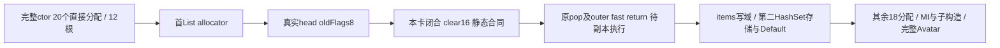

# F-03d3f4d2 / A-GC-OLDFLAGS8：实际32B head的清理合同

**实际 `oldFlags=8` 的必要callee已经闭合到一个可交实施的最小静态合同：`141fdf9c0` 的长度16分支只把真实head的 `[+10h,+20h)` 清零，并返回原目的地址。** 该分支没有GC回调、全局数据读或外部调用。本卡没有执行任何原指令、pop、副本写或live API；GC所有权、自然allocator线程、完整Avatar/g2/D-02均未因此通过。主线要求难点消解即交回，本卡不继续做机械执行工具或通用GC模型。

## 任务、复用与固定来源

起始HEAD `a38aef7592b24c7af7d22e7900c33d0aba0ab7b8`；用户已恢复持续D-02，历史暂停不限制本卡。独立计划、原件和执行记录只放 `local/migration72/d02-resume-20261110b/a-gc/`，下文相对该目录简称本卡根。本卡只新增本文和本卡忽略目录，不改旧pin、共享索引、helper、Proto、运行代码或资源；Git/共享文档由主线统一处理。

直接复用 [AB stock v2实测](CLIENT_72_D02_AB_STOCK_V2_20261110.md)、[完整head合同](CLIENT_72_D02_AVATAR_CAPTURE_ALLOCATION_SPEC_20261110.md)、[TLS单窗](CLIENT_72_D02_AVATAR_TLS_SUCCESSOR_20261110.md)、[第二allocation规格](CLIENT_72_D02_SECOND_ALLOCATOR_SPEC_20261110.md)及已验String getter/owned字符比较。本次没有重新跑ABI、getter、Equals、Hash或FindEntry；自然Hash/FindEntry的tuple/caller/trigger继续未知。旧epoch的VA/bytes只作离线输入，不被称作当前现场。

| 固定原件 | 完整SHA-256 |
| --- | --- |
| 国服7.2 EXE，450927000B | `8b014f64b5dc12fbc476e0c362b053abfdd7a1378cd282e4ad81057621dbd6b5` |
| profile（其余四输入由此完整固定） | `a3b9eda630942ba8479f713fc1692c7eb7b05198ae382dfe878ecc963051fd5d` |
| AB v2原capture，3006996B | `425a97895a4217c86e4afcffaf37b151f299b2b37a332e95f1b0178cbf218fa7` |
| AB v2主线原件审核 | `d6ad7d00f2656c017e74fbf828683fe8d2be98c54800db87e28a3558009338fb` |
| 完整Avatar ctor1661B | `1b6d394af556f8647e6ee911cd32de784078ab64e29fb9fa37d3368019cd0f5e` |
| typed allocator420B | `c6b7251e6025e0accc5fc41e2083852d59a67671875a338738bd3c922250f1a2` |
| pop312B；原manifest | `8ce320df866d328376e990489907ab22f973e2d087ee7c1e0c415c8fb8ee3a7c`；`5bc6ecb1349c6f42f884a98ff1d8634855ff6dded0d813b441ec26d36d1b296c` |
| post-pop409B | `cd03c4e7f6d80a3f5f1d3f3744f0013dead6bdec82615559db73b25b8bd39e14` |
| HashSet零参ctor201B | `ac214998df8fd99397a345192248ca9a43d4b22ec74c374c05fb5e4dc20d2550` |
| 本次904B helper原机器码 | `34287f706e27541c8119091aa9e55c7e2916610935f90c9b74992856b9654b31` |
| 本次helper原12B pdata；manifest | `d56e1bc42b22adb681a4c0b03e40b3ada8cb149f4602bde5d9796082a283e201`；`73b50cba66ee3aed2a7b2c3f1b3a772104da6219686b3dd9fccc915f30c36915` |

全部18个输入的大小与完整SHA保存在本卡 `input-pins.private.json`，SHA `a0464baced66b58c38c96a526b9e349af9ca9a9adee8bbacc4c30558d0dc01a7`；包含原groups、83-source快照manifest、第二allocation原证明和本次边界。不是通过改变旧文档pin接受新来源。

## 完整Avatar构造依赖，先于单块出口

1661B完整窗为 `15183fe60..1518404dd`，正常ret `15184033a`。20个直接allocator site、12个usage根均已从原call/RIP bytes复核；不等于自然执行20次或同bin需要20块。以下是正常体全部直接分配路径；“存入”仅为原指令职责，不表示本epoch已执行。

| 原allocation site | class usage RVA | 后续存入/依赖 |
| --- | --- | --- |
| `15183fe84` | `588ca20` | List→Avatar+70；本次仅有这一块真实32B head |
| `15183fea8` | `5897cf0` | 零参HashSet ctor→Avatar+a0；实际class/U16=56/bin4已采，第二record/block/Default未采 |
| `15183fec8` | `58fd7c8` | `157d7fe90`及`ff11 call rsi`→Avatar+1e8 |
| `15183ff21` | `588f388` | items原QWORD→对象+10→Avatar+68 |
| `15183ff45` | `58fd7d0` | `ff71 call rsi`→Avatar+1c0 |
| `15183ff81` | `58fd7d8` | `ffb4 call rsi`→Avatar+50 |
| `15183ffc1` | `58fd7d8` | `fff4 call rsi`→Avatar+1c8 |
| `151840004` | `58fd7d8` | `40037 call rsi`→Avatar+40 |
| `151840044` | `58fd7e0` | MI/RGCTX slot值→对象+10→Avatar+88 |
| `151840082` | `58fd7e0` | MI/RGCTX slot值→对象+10→Avatar+1f0 |
| `1518400c0` | `58fd7e0` | MI/RGCTX slot值→对象+10→Avatar+b8 |
| `1518400fe` | `58fd7e8` | static缓存/条件producer链→Avatar+1f8 |
| `151840176` | `58fd7e8` | static缓存/条件producer链→Avatar+200 |
| `1518401ee` | `58ed020` | MI/RGCTX slot值→对象+10→Avatar+1d8 |
| `15184022c` | `58a31c8` | 保存wrapper，最终→Avatar+b0 |
| `15184023b` | `58a31c0` | `14ff00c60`子构造→wrapper+20 |
| `151840256` | `588ca20` | 第二个List/items→wrapper+10；不能复用首块作第二对象 |
| `15184027a` | `58d6e70` | `15152d870`子构造→wrapper+18 |
| `15184029c` | `588f388` | items原QWORD→对象+10→Avatar+60 |
| `1518402c0` | `58fd7e8` | static缓存/条件producer链→Avatar+1e0 |

正常体其余全部call边是：`feb5→157d97690`、`feeb→157d7fe90`、五个`call rsi`（`ff11/ff71/ffb4/fff4/40037`）、三个条件producer链（`40134/401ac/402f6→140517680`，`4013d/401b5/402ff→140538230`，`40145/401bd/40307→159b6e720`），以及 `40246→14ff00c60`、`40285→15152d870`。简写site均以完整入口高位为准，完整地址和每条原call bytes列于本卡报告的 `constructor.allCallSites`。错误/缺槽分支另调用 `1404c2be0`、`140524010`，并有末尾int3；不能给这些边host成功。

已有metadata/AOT、泛型/enum及装备/技能/Ornament等有限owned子片段可复用，但它们没有给本epoch供应所有分配存储、MI/RGCTX/Default或静态缓存。当前覆盖层次是：完整源图已列全；首List同epoch候选已取；第二HashSet身份已取且201B零参热路径规格已审；剩余运行图及实际经过子构造未闭。首allocator内部CA/ordinary解析、空context/head、notify、post-pop初始化等真实不同分支仍按原合同停止。



## 原件边界与准确caller入参

先写 `plan.zh.md`，再只检查固定EXE exception目录；`boundary-candidate.private.json` SHA `050f5682017be2ad95af1fd83519e5948df13678caec160c8c12bdc810ad3c73`。唯一记录ordinal157493、RVA `1a6b40bc`，原12B `c0f9fd0148fdfd016cfb5705`：begin `141fdf9c0`，end-exclusive `141fdfd48`，904B，unwind RVA `557fb6c`。begin恰等于直接callee，完整file-backed/可执行，落在预先限定4096B上界。随后只提这904B与12B pdata，连续解码176条；没有取相邻gap、xdata、jump-table、外部callee或第二函数窗。历史路径仅用来选择全SHA核过的文件，不选择当前进程。

AB实采的完整head32B首读与final逐byte相同；SHA `b95fbb932f9ff76de2a3b68f3329ae0a44a6c64d275e54ac9662fd949620fb12`。本卡复核原62条请求的31+31地址/宽度/bytes一致，完整head的第8字节为08，实际record+18的U64为32。

| 原site / bytes | 来源及结果 |
| --- | --- |
| `140563d60 0fb64608` | 从旧H+8取AL=08；发生在新flags store前 |
| `140563d6f 4c8b4118` | 从实际record+18取R8=32 |
| `140563d77 a808`；`d79 740f` | test旧AL bit08；08不走skip |
| `140563d7b 4983c0f0` | R8=32−16=16，保留原64位算术 |
| `140563d7f 488d4e10` | RCX=原RSI=H，加10h |
| `140563d83 31d2` | EDX=0，故DL=0 |
| `140563d85 e836bca701` | rel32独立重算141fdf9c0；原return140563d8a |

## 长度16的完整合同

实际只经过以下15条，不需要通用body其余输入：

```text
141fdf9c0 488bc1                 mov rax,rcx
141fdf9c3 4c8bc9                 mov r9,rcx
141fdf9c6 4c8d15330602fe         lea r10,[module base]
141fdf9cd 0fb6d2                 movzx edx,dl
141fdf9d0 49bb0101010101010101   movabs r11,0101010101010101h
141fdf9da 4c0fafda               imul r11,rdx
141fdf9de 66490f6ec3             movq xmm0,r11
141fdf9e3 4983f80f               cmp r8,0fh
141fdf9e7 0f8783000000           ja 141fdfa70       ; 16>15
141fdfa70 660f6cc0               punpcklqdq xmm0,xmm0
141fdfa74 4983f820               cmp r8,20h
141fdfa78 770c                   ja 141fdfa86       ; 16<=32,不跳
141fdfa7a f30f7f01               movdqu [rcx],xmm0
141fdfa7e f3420f7f4401f0         movdqu [rcx+r8-10h],xmm0
141fdfa85 c3                     ret
```

DL经过零扩展和byte重复形成128位fill值；这次DL=0。`R8=16`时两个store地址相同，**两个16B写事件、唯一16B写域 `[H+10h,H+20h)`**，不能把第二个同址事件消掉。实采原16B为 `01000000000000000000000000000000`，含真实非零dirty byte；其余bytes来自原完整head，不为测试注入dirty或补零。helper没有读取目的存储；未来dirty证据应记录两写各自old/new：第一次覆盖真实01，第二次覆盖第一次的结果。

helper的RAX为**H+10h**，不是popped H；原pop在 `140563db6 4889f0` 才用原RSI重新设置RAX=H。helper不建新栈帧，ret消费原caller return；没有callback、GC状态访问、jump-table、额外内存读或异常分支。返回值和寄存器变化必须来自原指令，不能由host memset或host返回模型替代。“通用byte填充实现”的推断只由本体数据流支持，不据此命名完整运行库版本、导出符号或GC业务类型。

通用body仍未闭：长度0..15在 `141fdf9f3`读 `B+6d190b0+4*n` 并间接跳；>32从 `141fdfa86`起读CPU/阈值全局，另有三个尾部分派表（RVA `6d190f0/6d19114/6d19138`）和条件外跳 `141fdf9a0`。其具体全局RVA/原PC在报告中逐项保留。本卡未提这些表/全局/外部body，不批准其他长度、AVX/NT/REP或其异常透明性；这不妨碍当前准确16分支闭合。

## 下一可实现规格与验收上限

交Sol xhigh/Terra的是**同一AB原始候选输入的离线副本，原首pop→此15条→原pop/outer fast-return的限定执行**，不是通用runtime；无需新live采集、TEB query、第二record或PE窗。沿用源绑定的class、TLS、record、完整head、actual GS58/TEB等价和明确owned控制栈；所有实际地址按捕获ASLR关联。受控primary选择仍不证明自然allocator线程。若没有来源明确的原constructor frame，只能称受控allocator单元执行，不能把人工return标成自然ctor返回。

原六个pop字段写域保持：M+19cc/1、R+10/2、R+20/8、H+0/8、H+8/1、C+8/8；**只增本helper两个PC对H+10/16的精确副本权限**。合计七个unique span、44B字段范围；state写两次、helper同址写两次，正常支持路径合计九个捕获写事件。其余head bytes、原件、class/global/next block只读；不可全页放写。原C7=1、CA=62、notify=0支持已有post-pop fast-return，不强改条件。任何偏离准确原PC/地址/宽度、未提供读或别的callee均在执行前拒绝。

只把原数据流预期作为待验断言：R+20接原H[0:8]；word218→219；C+8的7616→7648；H+0为去低3位的本轮真实class；H+8为01 OR80=81；state1→5→1；H+10..20由实际两条store清零；helper RAX=H+10后原pop/outer RAX=H。所有old/new、PC、宽度、原call/ret/RSP、原件前后hash必须真实记录，不由本卡预测填充成运行结果。

最小出口是原outer返回到其受控caller；如确有完整source-bound ctor连续帧，可在 `15183fe89`核RAX=H后停止，最多执行已知test/branch并停在 `15183fe92` 前。items的QWORD已在AB取得但身份opaque，后面的 `H+10/8`、Avatar+70写域以及第二HashSet分配不包含在本包。之后仍先按第二allocation规格补真实record/block/Default，不把首块成功扩为完整构造。GC所有权不是本有限离线副本语义的已证明前提，任何结果也不得反向声称该所有权已成立。

当前权限仍全部false：`nativeCPUExecuted/capturedCopyWriteApproved/liveAPIInvoked/GCObjectOwnershipProven/naturalAllocatorThreadProven/completeAvatar/d02Passed`。以上是供主线独立审核后实施的规格，本卡不自行启用任何权限。

## 实际离线验证、复现与GitHub补查计划

`audit-contract.private.py`两次独立Python进程均exit0；核18完整pin、31+31实采记录、真实head/dirty16B、9个caller opcode、904B/176条连续解码、15条准确路径、两次同址写和20site/12根完整call清单。两份语义报告各20630B，逐byte相同，SHA **`ff87585ad28ea59ad0fbe7f62a6e5bee9f5fd074f5ca7343e555abcc869b952c`**。真实argv/UTC/exit/stdout/stderr分别保留，未为同SHA改写运行元数据。主线可独立第三次运行：

```powershell
python -B local/migration72/d02-resume-20261110b/a-gc/audit-contract.private.py --output local/migration72/d02-resume-20261110b/a-gc/contract-main-third.private.json
```

本卡没有新增受跟踪tool/test，未执行emulator、目标native/owned CPU、客户端/调试器、Windows backend API、网络、构建、JVM/DB、安装或Git；只读固定PE增加一个904B原窗。仅文档/离线研究无需GS重启。下一步是主线审核后交明确实施，释放max槽，不再扩窗。

本新缺口的中文GitHub增量计划已先交主线安排Terra max，尚未由A执行网络检索：先复用仓库外现有clone/固定manifest，列准commit/tree/license和branch覆盖；仅补CRT/IL2CPP中与新窗精确指令相符的byte-fill/allocator清理调用职责，不重做AstaPS资源、phnt/TEB、patch或String研究。重点核有相关成果的分支；候选例如公开Microsoft相关AMD64 memset实现引用，必须以准确primary文件验证，不能把仓库名当命中。上界10分钟/12网络调用、最多3库×2相关公开branch，失败/partial及manifest/result/ledger完整保存；可复用仓库才克隆到本仓库外，不执行/编译或批量vendor。外部相似实现不能覆盖本904B原件，也不能扩成GC/其他长度许可；本次16分支已由原bytes独立闭合，无须等待该补查才交实施。

任务ID、完整构造未闭项和准确最小出口均已交回；共享Project/Harness/交接与本地提交由主线维护。完整Avatar/Scene/资源、自然route/认证和D-02六项实机继续未完成。

主线已独立运行本卡第三审计，18pin/15条/两次16B原写静态范围与双fresh同SHA `ff87585ad28ea59ad0fbe7f62a6e5bee9f5fd074f5ca7343e555abcc869b952c`；后继副本执行由独立FIRST-POP-COPY另验，不回填本卡CPU结论。
