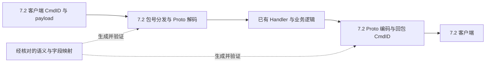

# 7.2 迁移现状与本地运行基线

2026-11-06 F-02b/F-03本批限定融合已验收并暂停，运行提交4bbf9fd，D-02未执行。468研究/43套761 Java/五生成检查全过；结构0/ready205。便携构建24秒，JAR `570d64f4f1680ab023c7eda7f2e930ebf5eba79791030e8499100ca8f2799bf5`内嵌4bbf9fd，92变化+114新增class匹配编译、109账号/Guard/Lua保持。前置不足未部署、无服务/测试监听；客户端目标当前未见原因未知，未操作调试器。下文更早的数量与暂停均为历史，当前以../Project.md及../HANDOFF2.md为准。

已接入范围见[融合记录](CLIENT_72_ASTAPS_FUSION.md)、[响应合同](CLIENT_72_RESPONSE_CONTRACT.md)、[八握手](CLIENT_72_SCENE_HANDSHAKE.md)、[请求省略](CLIENT_72_SCENE_REQUEST_CONTRACT.md)、[1017域](CLIENT_72_CMD1017_DOMAIN.md)、[容量](CLIENT_72_STORE_WEIGHT_CONTRACT.md)、[最小入场](CLIENT_72_ENTER_SCENE_CONTRACT.md)。27个三层行含嵌入Vector用途别名；Cmd/类型21 verified，schema10 verified/11 candidate/6 unresolved，239字段65 verified/9 candidate/165 unresolved。P0依赖闭包仍unresolved，原种子不是完整必需序列。

后续优先复用已有字段图/消费偏移，补PlayerData/PlayerStore/Avatar完整初始化及未命名ownerUID/world/time/dungeon等具名目的地；不把raw图、上游0/旧号/20000+或同形当业务证明。SDK/信任、补丁ABI/路由和最小资源另有前置；本批未部署、未启动客户端、未确认新旧号实机/场景/心跳/重登。

2026-11-06融合最终状态：F-01来源审计和F-02a四schema/45字段/3包号已完成限定验收，按用户要求暂停。399研究、43协议及关联、589账号/经济/保存/Lua分别全过，portable构建23秒；矩阵65→67输入，原三层状态/开放边界未晋级、ready仍228。未部署或进行新实机阶段，D-02仍未验；见[融合记录](CLIENT_72_ASTAPS_FUSION.md)、Project和HANDOFF2。以下“当前恢复”与旧暂停段落为本日更早历史。

2026-11-06当前批：[固定AstaPS融合](CLIENT_72_ASTAPS_FUSION.md)，任务F-01～F-05见Project。用户已覆盖旧暂停，并随后明确本轮先融合、对应验收及维护文档后暂停；D-02保留未完成，不推进新实机阶段。以下暂停基线和测试数量为历史记录。

最新收尾（2026-11-06，已暂停）：B-02e7（51f7cd2）16有限结果及E-01c5（9aa8ca7）真实生产加载限定完成；最终384研究回归通过，63→65输入仅新增证据hash，三层/源码/候选/开放边界不变、recover双跑，结构0/ready228。实际fast437组部分求值/481错误，inline13,616组零错误；与旧纯求值407明确分开。当前JAR仍2566f466…83fe，根fastRequire=true未改，未修生产或部署。用户要求完成当前两项后暂停，现不启动下一项，详见[交接](../HANDOFF2.md)；D-02实机未验。

最新整合：B-02e3阶段13样本与正常消费14样本双跑；E-01c2四处最小生产修复后13,616静态组/20,871套件完成、仅保留8缺ID。327研究与580 Java选集全过，便携JAR 4dd1c47a…bbe7已构建，完整P0/SDK/补丁/资源前置未齐故未部署。实机仅只读启动/存储证据，SDK/登录/场景和D-02均未验；详见Project及CLIENT_72_SCENE_SERIALIZATION_FIXES。下方旧数量为各历史批次。

> 本文保留迁移起点及研究方法；持续任务/验收在 [Project](../Project.md)，实际工具与复现入口在 [Harness](../Harness.md)。下文“本次本机验证”属于此前基线记录，不能作为后续构建或 7.2 验收。当前未完成 7.2 适配。

2026-11-06继续：用户允许参考7.1实现迁移Lua，见[E-01c实际脚本核查](CLIENT_72_SCENE_SCRIPT_MIGRATION.md)；B-02e2新增[入场通知/缓存等待](CLIENT_72_SCENE_WAIT.md)，两层身份核实但26业务字段未知。305项离线研究回归通过，当前调试目标保留运行/key槽空，完整SDK/协议/资源及D-02实机均未完成；不以历史基线或离线结果解除准入。

核查日期：2026-11-05。主仓库起点 `167d716`，补丁 `f2874103ab70afc56260ee12d1eaca96247933b2`，资源 `dac2a9d43332ef51879522cf39da2831b0ca0543`。当前服务端仍声明并实现 7.1；本次建立便携运行基线及迁移审计工具，不代表已完成 7.2 适配。

## 当前证据

| 项目 | 核查结果 |
| --- | --- |
| 目标客户端 | `config.ini` 声明国服 7.2.0；可执行文件和元数据与已验证的 7.1 提取器配置均不同 |
| 协议 | `src/main/proto` 有 2803 个源文件；`PacketOpcodes` 注释及登录/入场测试仍固定 7.1；427 个负命令号常量尚未解决 |
| 版本准入 | `RegionHandler` 检查主、次版本，7.1 服务端会拒绝 7.2 |
| 资源 | 当前资源 README 明确以 7.1 为中心；未提供可验证的 7.2 服务端资源表 |
| 提取工具 | `extract_client_type_names.py` 校验三份文件哈希，并包含 7.1 专用解码参数与地址；不能跳过哈希验证后套用到 7.2 |
| 补丁 | 14 个已纳入审计的静态特征中，目标客户端匹配 7 个，未匹配 7 个；命中不等于回调 ABI、字段偏移或运行行为已验证 |
| 客户端完整性 | 根目录存在 `BeyondAssets_CN_7.2.0.49085326.zip_tmp`；尚未验证整份安装完成，不能单凭此文件断言客户端损坏 |

未匹配特征：`SDK_GET_REQUEST`、`SDK_POST_REQUEST`、`SDK_PRODUCT_RESPONSE`、`SDK_PRICE_CACHE_RESULT`、`SDK_PRICE_QUERY`、免费充值 `RESPONSE` 和 `FINISH_WAIT`。这是当前补丁对所提供文件的静态扫描结果，不能代替真实加载后的验证，也不能把可选商城功能问题当成所有登录失败的原因。

目前没有目标版本的 Proto、CmdID/名称映射或完整资源表。已有 7.1 回归测试只能保护迁移前行为，不能证明 7.2 的字段编号、类型和嵌套消息兼容。

## 便携运行

按 [部署手册](CODEX_ONE_CLICK_DEPLOY.md) 使用当前 checkout 的 `Start-GS.cmd`、`Stop-GS.cmd`、`GS-Status.cmd`、`Play-GS.cmd`。前次验证使用的是 7.1 配置，这是历史运行记录；本分支后续只面向 7.2。在 7.2 连接前置条件具备后切换本机客户端配置，此前可通过命令行参数只读审计目标客户端。

复制工作区后，先备份配置和存档，检查 `.env/.env.local` 的资源路径以及 `config.json` 的 `folderStructure.resources/data`。便携入口现拒绝跨工作区的数据路径和非本机便携 MongoDB 地址，避免启动新 Fork 却读取旧目录；不会自动移动或覆盖存档。需要外部资源时同时设置 `LUNAGC_RESOURCES_DIR` 与配置字段。

默认 JAR 名称从 `build.gradle` 派生；便携 build 支持 `LUNAGC_JAR` 简单文件名并向 Gradle 传递一致的产物名称。版本字符串仍保留 7.1.0，待真正完成对应协议和资源适配后再修改。停止、构建、启动依次执行，不并行更新。

start 复用进程和 status 检查会核对当前 JAR、进程与 `local/running.json` 的启动哈希；磁盘产物已改变时要求正常重建重启。切换文件名后 stop 仍能识别本工作区的旧 JAR，不会将其他工作区的 Java 进程当成本服务。

本次本机验证：JAR 重新构建成功，HTTP 健康、TCP 8088 / UDP 22101 的 Java PID、MongoDB dbpath、磁盘与启动记录的 JAR SHA-256 均已核对，7.1 补丁状态通过。39 项脚本测试和 5 项 `Protocol71CompatibilityTest` 通过。配置及已有数据库/运行数据已留存停机副本，未做恢复演练。启动日志仍报告部分 BIN 任务资源不完整；真实客户端登录和玩法尚未操作。机器路径、PID、哈希和原始审计报告留在被忽略的 `local/`，这些结果不是下一台机器的验收结论。

## 可复用的只读核查

```powershell
python tools/audit_client.py --client '<目标客户端目录>' --output local/client-audit.json
python -m unittest tools.test_audit_client tools.test_local_windows tools.test_patch_game tools.test_runtime -v
```

工具记录客户端关键文件的 SHA-256、三份源码提交、当前服务端登录/入场命令号、提取器哈希匹配情况及补丁静态特征匹配数量。报告包含机器路径，应保存在被 Git 忽略的 `local/`。文件哈希用于标识输入，不认证来源；工具不修改客户端，不执行提取、登录或发放物品，退出码 0 只代表审计完成。

## 后续迁移顺序与验收

1. 核对完整 7.2 客户端，获得对应的协议定义、命令号/名称映射，或为这组 EXE/metadata 建立新的、经验证的提取器配置；已有 7.1 资料仅用于分析对照。
2. 优先更新 dispatch、GetPlayerToken、PlayerLogin、Ping、选人和场景入场链路，逐包验证字段编号、标量类型、嵌套消息及请求/响应配对。使用真实 7.2 样本锁定测试。
3. 整理 7.2 Excel、BinOutput、Lua、文本和场景资源的来源及版本，比较新增与变更记录，避免按行号合并，也不覆盖现有子模块未提交内容。
4. 核对补丁的加载、HTTP/SDK 路由、密钥和每个回调的对象布局。可选功能缺失单独记录；不把签名未匹配的钩子强行安装到猜测地址。
5. 使用隔离测试存档验证真实客户端登录、创建角色、进入世界、移动、传送、战斗和退出重登，然后逐项验证深渊、商城和新增内容。遵循各专题接手手册。
6. 验收后更新版本声明与适配文档，重新构建、正常停服并部署，核对健康、端口 PID 及运行 JAR SHA-256，再提交到本地 Git。

服务健康、补丁静态命中和编译通过都不能替代真实客户端验收。当前 7.2 登录/入场/存档验收尚未执行。

## 7.2 适配执行方案

本节为待实施方案，目标是使这个 LunaGC 分支原生处理所提供的国服 7.2 客户端协议。这里的“映射指令”指网络消息的 CmdID/Opcode、消息类型及字段语义；`give`、`teleport` 等 GM 文本命令不是同一层，通常复用现有业务入口，另行核对资源 ID。

实施基线为 `d64d9cc`。本节中的新目录、工具和测试名是拟交付内容，尚未实现；不得将本方案当成已经取得 7.2 映射表或已完成客户端验收。

### 1. 采用单版本 7.2 协议构建

按用户于 2026-11-05 明确的范围，本身就是独立、干净的迁移分支，直接以 7.2 为唯一目标。不要求保留 7.1 回退构建、运行环境、兼容层或双版本支持。7.1 源码及已有提取结果仅作为理解现有业务和恢复语义映射的参考，不构成持续维护目标。

映射表是从客户端证据生成服务端协议代码的输入，不在收包后仅把 7.2 包号改成 7.1 包号。消息内部的字段编号、类型、枚举及嵌套消息也可能变化，旧 Proto 解析新 payload 即使不抛异常，也可能读到空值或错误含义。



尽量保留 `GetPlayerTokenReq` 等语义名称和现有 Java API，让成熟的账号、存档、背包、场景逻辑继续使用。发现真实的语义变化时再修改业务代码；不能为了保住旧 API 而捏造目标客户端不存在的字段。

当前 `@Opcodes(PacketOpcodes.X)` 使用 Java 编译期常量，Handler 直接调用生成类的 `parseFrom`，发送包也直接使用生成类。故替换一个运行时 JSON 包号字典不能完成适配；确认后的映射必须生成/更新常量与 `.proto`，再重新编译。

### 2. 建立可追溯的三层映射

| 层次 | 要回答的问题 | 产物 |
| --- | --- | --- |
| 网络指令 | 哪个方向的哪个 CmdID 对应哪个客户端消息类型？ | `opcodes.json` |
| 消息语义 | 7.2 混淆类型对应哪个稳定业务名称、请求/响应关系？ | `message-map.json` |
| 字段语义 | 每个业务字段在 7.2 的 tag、类型、容器和嵌套结构是什么？ | `field-map.json` 及 `.proto` |

建议新增 `protocol/cn-7.2/` 保存可审核的映射、客户端 profile 哈希、别名关系和来源摘要；原始 EXE、metadata、反编译输出和本机抓包留在 `local/protocol/`。机器绝对路径、账号标识和会话令牌不进入已提交的证据样本。

单条消息至少记录：

```json
{
  "semanticName": "GetPlayerTokenReq",
  "direction": "C2S",
  "cmdId71": 23252,
  "clientType72": null,
  "cmdId72": null,
  "aliases": [],
  "wireStatus": "unresolved",
  "semanticStatus": "unresolved",
  "runtimeStatus": "not-tested",
  "evidence": []
}
```

这个例子的 `23252` 只来自现有 7.1 源码；所有 7.2 值都必须等待证据。字段表另记 `semanticField`、`tag71`、`tag72`、`scalarType`、`cardinality`、`nestedType`、`enumMap`、`oneof`、`packed`、`presence` 和证据引用，不依赖字段排列顺序。

状态分别保存，不能用一个“匹配率 95%”替代事实：静态提取成立，不代表业务含义已确认；业务含义确认，不代表客户端实际收发通过。候选映射可以用于分析，进入可连接构建前必须通过规定的协议验证；进入交付状态还需实机验收。

### 3. 阶段 A：锁定输入并恢复 7.2 类型信息

1. 固定目标客户端的版本、渠道、EXE/global-metadata/startup-metadata/SDK 哈希，核对安装清单及未完成下载项。后续热更新改变这些输入时重新审计。
2. 用现有 `audit_client.py` 记录 7.2 输入，按需利用已有 7.1 类型、成员、方法和包号资料辅助匹配；不要求重新搭建 7.1 环境或完整重导旧版本。
3. 将 `extract_client_type_names.py` 适配为经文件哈希校验的 7.2 提取器，并建立对应测试；不要求维护双版本 profile 或旧客户端提取能力。
4. 在 7.2 中重新定位元数据头、类型/成员表结构、名称解码、Code/Metadata Registration、方法指针及字段布局。不能只改三条 SHA-256，或沿用 7.1 地址和解码常量。
5. 重新识别包号 getter/注册表的语义。现有脚本依赖混淆方法名 `AEGNNPENLNM` 和 `mov ax, imm16; ret` 形状；它们是 7.1 观察值，7.2 未必使用同名或同形状。提取失败要记录原因，不扩大指令模式去吸收无关常量。

这一阶段输出类型与方法索引、CmdID 候选表、提取完整性报告。所有访问必须满足索引、区间、类型引用和可执行地址约束；抽样验证基础类型、泛型和多个消息族。若无法恢复结构，当前阶段保持未完成，可以转向可验证的同版本协议来源，不能以猜测字段继续写入真实存档。

### 4. 阶段 B：从混淆类型恢复稳定消息名称

先在 7.1 建立“语义名 → 混淆类型 → CmdID → 字段/方法结构”的对照，再为 7.2 生成候选对应关系。

候选排序使用类型/容器组合、嵌套类型关系、枚举集合、父类接口、序列化结构、方法调用关系和调用场景。建立消息依赖图，从结构清楚的叶节点逐步向外匹配。字段顺序、混淆名字、旧 CmdID 和 RVA 相近都只能是弱线索；同结构的空消息和简单请求必须保留歧义。

优先建立登录、心跳、选人和场景握手等锚点，再沿引用和调用关系扩展。交叉核对至少两类证据，例如客户端注册/getter 与调用点，或序列化函数与受控操作样本。不同的重复抓包不算不同来源的静态证据。

CmdID 值必须先绑定到目标类型，再绑定到语义名称；不能假设“7.1 CmdID 加固定偏移”或请求号相邻就是响应号。一个旧消息可能在 7.2 拆分、合并或被删除，应显式记录这些情况。

当前静态盘点有 3273 个数值常量：2845 个正值、2564 个不同正包号、279 组正包号重复及 427 个负占位常量。重复项包含语义名/混淆名别名，不能统统判为冲突，也不能默认全部合法。每组必须指定唯一规范名称及允许别名；这组统计是常量盘点，不代表运行时注册的 Handler 数量或功能覆盖率。

### 5. 阶段 C：恢复并验证 7.2 wire schema

优先利用可验证的 descriptor 或字段常量；缺少时结合客户端序列化/反序列化、size 计算、字段访问和受控样本恢复。对象内存偏移不等于 Protobuf 字段号；`.proto` 的 Java 语义名也不是线上的识别键。

逐字段确认 tag、标量类型、重复/单值、map、嵌套消息、oneof、packed、presence 和枚举数值。Protobuf 的字段键由字段号与 wire type 组成，但一个 wire type 可对应多种业务类型；长度分隔数据也可能是字符串、bytes、嵌套消息或 packed 数组，所以单看抓包不足以确定完整 schema。[Protobuf 编码规范](https://protobuf.dev/programming-guides/encoding/)

用重复操作控制变量来验证含义，例如分别改变语言、所选角色、场景、数量、目标 UID；涉及写存档的操作使用测试账号和隔离数据库。零值/空列表不会充分暴露错误字段，样本应覆盖非零、负值（类型允许时）、64 位 GUID、Unicode、多个嵌套元素及异常返回。

当前 `.proto` 同时含混淆类型、历史恢复定义和高编号字段，例如登录消息中存在 `50000+` 字段。它们需要逐项核对来源，不能因“已经编译通过”就视为目标版本依据，也不能仅凭编号高就断言是假字段。`recover_missing_protos.py` 恢复历史 schema，不能生成 7.2 的兼容性证据。

只更新 `src/main/proto`，Java 由 Gradle/protoc 生成，不手改 `build/generated`。保持稳定 Java 名称时，仍按 7.2 实际定义调整字段 tag/类型及必要业务调用。未知字段不能假设能承载旧业务含义；Protobuf 允许保留未知字段，解析成功本身不是语义正确的证明。[Proto3 未知字段说明](https://protobuf.dev/programming-guides/proto3/#unknowns)

### 6. 阶段 D：接入双向收发，先跑通最小链路

| 优先级 | 消息/路径 | 完成标准 |
| --- | --- | --- |
| P0 连接前置 | SDK/dispatch、版本与渠道、路由、包头、加密握手与密钥切换 | HTTP 路由正确，游戏帧可解码；故障能区分 HTTP、传输、解密和协议分发 |
| P0 账号登录 | `GetPlayerTokenReq/Rsp`、`PlayerLoginReq/Rsp`、`PingReq/Rsp` | 新旧测试账号都可完成登录，心跳稳定，不因 tag 错误读取空账号或空 token |
| P0 新角色 | `SetPlayerBornDataReq`、实际的响应/通知序列 | 新账号可选角色、命名并继续入场；不能只验证已有角色 |
| P0 初始化 | `PlayerDataNotify`、`PlayerStoreNotify`、`AvatarDataNotify`、队伍/世界/场景初始化依赖闭包 | 必需列表、ID、枚举及嵌套消息能被客户端正确解释 |
| P0 入场 | `PlayerEnterSceneNotify`、`EnterSceneReady`、`SceneInitFinish`、`EnterSceneDone`、`PostEnterScene` 及关联通知 | 完整握手可重复完成，进入世界后不因缺失回包停在加载界面 |
| P1 世界行为 | `UnionCmdNotify`、移动、实体出现/消失、队伍与传送、Combat/Ability 调用 | 世界内移动、传送与基础战斗一致，聚合包内指令正确分发 |
| P1 持久化 | 背包与角色基础操作、登出、重登、重启服务后读取 | 测试数据正确保留，无重复扣除/发放或角色归属变化 |
| P2 既有玩法 | 任务、副本、深渊、商城、抽卡、邮件、家园等 | 按功能形成请求/响应/通知闭环，遵循对应系统接手资料 |
| P3 新内容 | 7.2 新角色、武器、场景、任务、活动及新协议 | 资源与新增处理逻辑配套，单独记录支持范围 |

P0 不是固定十几个消息的清单：从当前登录初始化代码及 7.2 实际连接序列枚举其完整依赖闭包，所有必需嵌套消息也纳入验收。当前 `SetPlayerBornDataRsp` 为负占位，处理器还允许配置包号覆盖；迁移时必须追踪这类旁路，核对 7.2 实际序列，不能直接假设旧默认回包成立。

接入时重点检查：

- `PacketOpcodes.java`、`@Opcodes`、`PacketOpcodesUtils`、发送包构造器、循环包/禁用包/调试列表、配置中的包号以及散落的字面量。所有正值均来自目标版本的已验证映射；旧正值不能作为默认回退。
- `GameServerPacketHandler.registerPacketHandler` 当前 `put` 可覆盖相同包号。增加两个不同有效 Handler 冲突时的明确失败检查；规范名与别名共享编号时只允许一个实际处理器，诊断名称确定生成，不依赖反射顺序。
- `UnionCmdNotify` 的外层字段、`UnionCmd.message_id/body` 和子消息 schema；只换外层包号不能使内部命令兼容。其他枚举分派的嵌套消息（如 Combat/Ability 调用）同样要独立映射。
- `GameSession` 当前用有符号 `readShort()` 读取 opcode，而 `BasePacket` 按 16 位写出。核对 7.2 帧定义后统一读取、范围和日志语义；覆盖 32767/32768/65535 边界，以及包头/负载长度不足、超限和截断。此处是待核查的传输边界，不声称已经观察到 7.2 使用高位包号。
- 请求配对与响应策略以证据为准，不能看到 `Req` 后没有立即发包就机械添加 `Rsp`。现有 `NO_RESPONSE` 只作诊断线索，需要排除异步响应、单向通知和聚合包。

### 7. 阶段 E：补丁与资源配套

补丁先确认满足登录所需的加载、HTTP/SDK 路由和密钥逻辑；静态特征命中后继续检查回调参数、对象布局和客户端行为。7 个未匹配特征按依赖划分：阻塞 P0 的优先修复，可选商品/价格诊断和免费充值完成钩子随对应功能验证，不能强装到推测地址。

资源以固定来源和版本导入，逐表按稳定 ID 对比新增/删除/变更，并验证相互引用。网络 CmdID、角色/道具/场景配置 ID、存档实例 ID 是三套不同标识，不能互相重编号。已有资源不完整警告和子模块未提交内容单独保留，不把网络适配完成等同于 7.2 内容资源齐全。

版本与产物、Proto、CmdID、补丁 profile、资源提交形成一组构建清单。在 P0 映射和最小资源集具备证据后，才制作明确的 7.2 开发构建并调整版本准入进行隔离实测；发布为“支持 7.2”还必须通过相应验收。版本检查不能成为绕过协议缺口的开关。

### 8. 自动化工具与测试交付

| 拟交付项 | 内容与失败条件 |
| --- | --- |
| 适配 `extract_client_type_names.py` | 7.2 哈希 profile；类型、方法、字段和 CmdID 的证据索引；结构不合法或版本不明时停止 |
| `tools/map_protocol_versions.py` | 生成候选映射、依赖图与歧义报告；不自动批准低置信度匹配 |
| `tools/validate_protocol_map.py` | 检查 canonical/alias、方向、范围、schema 引用、P0 必需集及未映射项；不能把 null/旧号写入目标表 |
| `tools/generate_protocol_sources.py` | 确定性输出目标 `PacketOpcodes` 与已确认 schema；支持 diff/check，不覆写尚未核对的业务内容 |
| 协议 fixture 与 `Protocol72CompatibilityTest` | 目标客户端样本解析、独立 wire 断言、双向字段含义、嵌套包、边界与错误响应；不能仅用同一套生成类自编自解 |
| 注册与初始化检查 | Handler 冲突、负包号不发送、不注册未知协议、P0 缺项阻断构建/连接测试 |
| 验收清单与覆盖报告 | 按登录/入场/移动/战斗/存档/玩法列验证状态、证据和剩余问题，不用总映射数量代替支持程度 |

样本测试按字段语义比较；不能把序列化字段顺序或 map 顺序当成恒定的逐字节输出。字节断言用于明确要求固定格式的片段，完整样本则同时核对字段值、未知字段和预期变化。[Protobuf 序列化顺序](https://protobuf.dev/programming-guides/encoding/#order)

现有 `Protocol71CompatibilityTest` 固定了旧版本包号和字段。7.2 接管同一 Java 包后，用有目标客户端证据的 7.2 wire 测试替换旧版本专属断言，不要求继续通过 7.1 兼容测试。旧样本可按分析需要引用，不能只删除断言而缺少新的验证。与协议无关的账号/经济/保存业务回归继续保留。

### 9. 运行验证和交付门槛

本分支使用独立测试数据库与运行数据目录，本机继续 Windows 便携方式。当前 MongoDB 固定 27017，补丁 HTTP 地址固定 8088；正常停止占用端口的本分支旧进程后，在经过检查的配置下运行 7.2，不安排双版本并行运行。若本机存在需保留的数据，仍按存档手册保护；独立代码分支不表示数据库可以自动清空，也不要求建立 7.1 存档回退链路。

最小可连接门槛：目标文件哈希固定，P0 双向包号与依赖 schema 全部确认，零未知 Handler 冲突，新账号选人和已有账号登录均可入场，心跳/退出重登通过。

基础可玩门槛：移动、传送、切队、基础战斗与背包行为正确，重启后测试存档保持一致，测试路径上的未知消息/异常回包均已解释或修复。

功能迁移门槛：按既有功能清单验证并记录退化项；7.2 新内容另列支持范围。不能把“能进世界”写成“7.2 所有玩法适配完成”。

每个阶段单独本地提交；仅修改文档/审计工具时无需重启。修改运行代码、配置、Proto 或资源后，正常停止旧进程，重新构建、启动，并检查日志、健康、端口 PID 和 JAR SHA-256。交付内容和验收均只针对 7.2，不以恢复 7.1 运行为完成条件。

### 10. 第一轮实施顺序

1. 产出 7.1 源码的实际收发清单、别名/冲突清单、P0 依赖闭包，记录已知与未解析项。
2. 建立 7.2 提取器 profile，首先恢复类型、方法和 CmdID 候选表。
3. 确认 `GetPlayerToken`、`PlayerLogin`、`Ping`、`PacketHead` 的映射与字段，添加独立 fixture；同时验证连接前置补丁和加密边界。
4. 补齐新角色、初始化通知、入场及 `UnionCmd` 的映射，形成首个可测试的 7.2 构建。
5. 完成隔离客户端登录/入场验证，再扩展世界行为、存档及玩法模块。

当前最先需要完成的是第 1、2 项，尤其是 7.2 类型与包号证据的获取。尚未完成提取器适配和协议来源核验前，不给出虚构的 7.2 CmdID 表，也不承诺固定天数内完成全部玩法。
