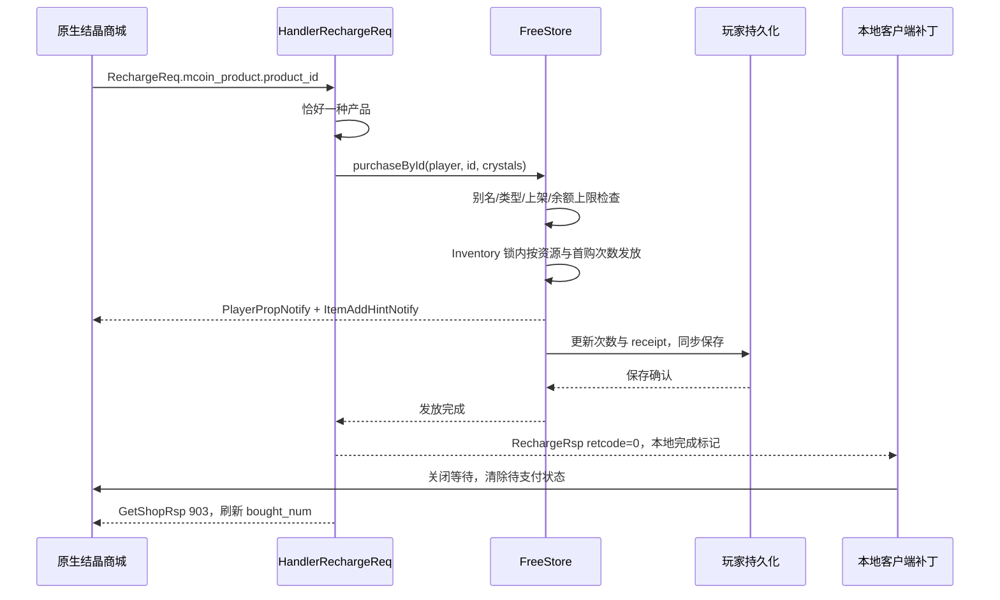

# 原生结晶免费充值：实现与验收

更新日期：2026-10-23。适用于当前本机 Windows 便携服务及配套国服 7.1 客户端补丁。入口是游戏内「商城 → 凝取结晶」：使用原来的六档商品、原生图片及首购/续购赠送，点击后由本地服务发放结晶，跳过支付。所有档位价格为 0，不接收付款，也不扣除原石、摩拉或其他游戏币。

总入口：[商城接手指南](SHOP_AND_RECHARGE_SYSTEM.md)；原系统的完整保存边界见[数据](SHOP_AND_RECHARGE_DATA.md)与[运维](SHOP_AND_RECHARGE_OPERATIONS.md)。本页描述这次增量，不能把它推广为月卡、纪行或千星产品的原生跳支付验收。

## 档位与美术来源

| 基础结晶 | 首次实际到账 | 后续每次到账 | 规范 key | 桌面 productId |
| ---: | ---: | ---: | --- | --- |
| 60 | 120 | 60 | crystals:1 | ys_chn_primogem1ststall_tier1 |
| 300 | 600 | 330 | crystals:2 | ys_chn_primogem2ndstall_tier5 |
| 980 | 1960 | 1090 | crystals:3 | ys_chn_primogem3rdstall_tier15 |
| 1980 | 3960 | 2240 | crystals:4 | ys_chn_primogem4thstall_tier30 |
| 3280 | 6560 | 3880 | crystals:5 | ys_chn_primogem5thstall_tier50 |
| 6480 | 12960 | 8080 | crystals:6 | ys_chn_primogem6thstall_tier60 |

数据来自 `resources/ExcelBinOutput/ProductMcoinDetailConfigData.json` 与 `ProductIdConfigData.json`，由 FreeStore 加载。每档独立记录首次购买；换平台别名不会重置首购，重登也不重置。没有新增年度重置功能。

原生资源的 `icon` 依次是 `UI_Mall_Purchase_Primogem1ststall`、`...2ndstall`、`...3rdstall`、`...4thstall`、`...5thstall`、`...6thstall`。商品卡片由客户端自己的商城界面创建并引用这些图片；本次没有下载、生成或替换图片。价格保留本地零价显示，其他档位身份与赠送数据使用现有游戏资源。

## 两个根因与修复

### 1. 有商品却显示“暂无购买项”

旧 `Shop.proto` 将结晶和月卡列表写反，旧 `StoreProtocolTest` 与旧文档也一起采用了错误结论。2026-10-23 对客户端泛型、字段偏移、protobuf 读取器与消费端重新交叉核对：

| 用途 | Shop 字段 | 原生偏移 | 元素类型 |
| --- | ---: | --- | --- |
| 结晶列表 | **1**，tag 0x0a | 0x30 | IBHFMGNJFID，类型索引 62721 |
| 月卡列表 | **9**，tag 0x4a | 0x18 | AGOAHICIIPE，类型索引 51075 |

Shop 类为 `GCJHMADLPID`（17784），读取器 `0x152917570` 分别访问上述偏移。`OFNMGCEGDIO.JOBDNGNICNC` 中 shop 903 分支在 `0x14c623716` 迭代 0x30。识别列表用途必须使用泛型元素及消费端，不能只根据 tag 推断。修正测试后先在旧 proto 上复现失败，再修正协议使测试通过。

### 2. 服务端已发奖，原生客户端仍打开支付 SDK

原生 RechargeReq 在支付之前发出。其成功响应处理器 `KLELAHKCBDB.MJODEAKHBPJ`（`0x149004b30`）随后才调用 SDK 的购买方法 `EHIAFLOHEIL.CBIBBAKNFKN`（`0x149653ae0`）。只把价格设置为 0 或只在服务端发奖，都不能完整实现点击直接到账。

现在服务端结晶保存成功后返回 `product_id = LunaGC.FreeRecharge:<规范 productId>`。补丁识别该本地完成标记后结束 UI 等待并清除待支付状态，不再调用 SDK 购买方法。客户端补丁自身不会修改结晶数量；资产来自服务端正常属性/物品通知。

## 请求、发货与 UI 完成顺序



- 入参奖励、客户端价格、伪造的 bought_num 不作为发奖依据。
- 无产品、多种产品、未知 ID、类型不符、下架、余额溢出：retcode=1，不产生成功标记。
- 运行时异常（包括同步保存失败）：记录服务端错误并回 retcode=1；不会发送成功标记或成功后目录刷新。
- 成功标记只覆盖结晶六档。未标记响应走客户端原处理器；月卡、纪行、千星等不自动套用此完成分支。
- 带前缀但 ID 错误或 retcode 非零的响应不会进入支付 SDK，补丁只清理等待并记录拒绝。
- `PacketGetShopRsp` 增加显式 ShopSystem 构造参数，购买刷新使用当前会话的服务实例；旧调用保持原入口。

## 补丁定位与兼容范围

源码：[free_recharge.rs](../patch/src/modules/free_recharge.rs)，由 HTTP 模块初始化。验证客户端 SHA-256：

```text
YuanShen.exe:
7f89938da606c1281659607d464702cddb9a09a7d4320a196630f60a811ec38e
global-metadata.dat:
469eccd43aa48fe7a2df4e1caf66fa1268a17f5a4a03fa209e1427e467cb0161
startup-metadata.dat:
90848967d3f9432e7a13caffcec999bf457ac3be1f2ae86336443a63acbaadcf
```

实现扫描两个当前版本的固定签名，已离线验证各只有一个匹配；不直接使用偏好映像地址。RechargeRsp 方法内 +0x56 的 RIP 相对加载解析单例地址，并检查紧随其后的 `globals + 0x9c70` 指令。

完成 UI 等待使用原生 `DAEMCCNOCPF.IEEDEMIGOHF`（`0x14ba84780`），参数与原响应错误分支相同 `(true, false, false)`；清理商城管理器 `0x78..0x97`，与原代码清理的 32 字节一致。签名或单例布局不匹配时记录不可用并跳过安装，不猜地址。

启动日志应出现：

```text
Local crystal checkout installed: native catalog, server grants, no payment SDK
```

每次本地成功确认应出现：

```text
Local crystal purchase acknowledged; payment SDK skipped
```

更新客户端版本后必须重新验证签名、对象字段和调用约定。不要仅因 DLL 能加载就宣称兼容。服务端与补丁应配套更新；未安装此补丁的原生客户端仍可能走其原支付 UI。

## 验证结果

2026-10-23 已完成：

1. Java 选集 **87 项通过，0 失败、0 跳过**：`emu.grasscutter.game.shop.*`、StorePriceRoutesTest、ShopBatchSaveTest、ShopTransactionConcurrencyTest。
2. 新 NativeRechargeTest 使用实际 Inventory 虚拟货币发放和 HandlerRechargeReq，验证六档首购/续购共 12 次、对应总额、原石和摩拉不变、忽略伪造数量、首购目录刷新、异常与余额上限。保存使用测试替身；不能解释为真实 Mongo 故障注入。
3. Rust 补丁全套 **48 项通过**。新增测试验证标记白名单、原处理器旁路/保留、管理器清理范围、等待关闭参数及字符串长度边界。
4. 本机便携服务重新构建，旧服务正常保存后停止，新服务健康正常；HTTP 8088、游戏 UDP 22101、Mongo 27017 正常。运行 Java 命令行指向根目录新 JAR，补丁重建并随客户端重启加载。
5. 用户实机明确反馈“已经能够跳过支付充值”。补丁日志同时记录成功确认且跳过 SDK。
6. 独立只读 Mongo 查询确认本机玩家 `crystals:6 = 12`、receipt 共 12 条、结晶 **101840**，与 `12960 + 11 × 8080` 一致；原石为此前界面相同的 **1000049**。这是数据库冷读，不只依赖客户端画面。未执行重登后的逐档 UI 截图检查，也未注入正式库故障。

此次部署校验值：

```text
LunaGC-7.1.0.jar:
949242f56d0a24acd5ff5ddeb4a9799f0a3ace9d6008f717d2d487f57b88399c
patch/target/release/ext.dll:
03cbd6070697202a40315ab42698944d57ae1d644b91ad8d73af67d35091e4bf
```

后续源码或构建更新后，以新的运行校验为准。复现 Java 选集可沿用[运维命令](SHOP_AND_RECHARGE_OPERATIONS.md#重现本次选集)并按本页选集调整；Rust 使用便携 CARGO_HOME/RUSTUP_HOME 后执行 `cargo test --manifest-path patch/Cargo.toml --locked`。

## 保存与排障边界

FreeStore 仍是既有免费模式：Inventory 进程锁、UUID receipt、最多 512 条记录、同步保存。它不是持久订单事务。发奖/物品通知发生在最终保存前；保存报错时内存可能已变化，不能反复点击并假设上一笔没发货。原生每次新请求生成新 UUID，因此没有实现跨请求重试幂等。

| 现象 | 检查顺序 |
| --- | --- |
| 凝取结晶仍为空 | 确认运行新 JAR；Shop 903 的结晶列表字段 1；六个产品启用；价格目录通知与 SDK tier 初始化 |
| 弹出支付 UI | 检查客户端是否重启、补丁安装日志、本地完成标记；不能用“零价格接口正常”代替此检查 |
| 到账但等待不消失 | 核对补丁签名、成功确认日志、UI 单例偏移和等待函数；不要再次发奖来解决 UI 等待 |
| 首充标签未更新 | 检查成功后的 GetShopRsp 903 与 bought_num，核对 Player 的规范 key 次数 |
| 重登数量异常/保存失败 | 停止重复购买，核对 players.properties.10025、freeProductPurchases、receipt 和保存错误；按账号存档指南对账 |

维护入口：协议改动同时更新 Shop.proto 和 StoreProtocolTest；商品/赠送改动复查资源表与 FreeStore；完成标记前缀必须同时更新 Java Handler 与 Rust 白名单；补丁行为改动同时更新对应单元测试，并重新构建和实机验证。
