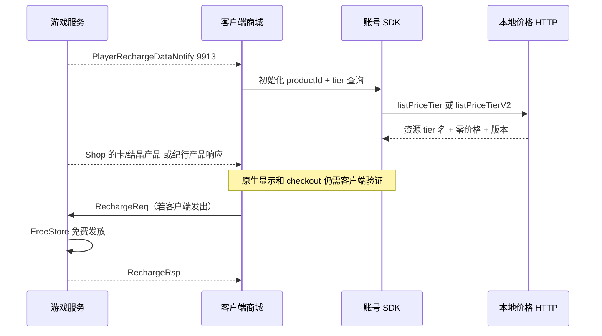

# 商城与充值：客户端协议与管理接口

配套：[总览](SHOP_AND_RECHARGE_SYSTEM.md) · [数据](SHOP_AND_RECHARGE_DATA.md) · [运维](SHOP_AND_RECHARGE_OPERATIONS.md)。核对日期 2026-10-22，基线 `519eb03386d19c4a62ecd74d4a83ac02427e0ba0`。

本页数字来自当前 [PacketOpcodes.java](../src/main/java/emu/grasscutter/net/packet/PacketOpcodes.java) 和 [proto 源码](../src/main/proto)。客户端逆向依据见 [7.1 协议证据](protocol-store-7.1.md)；该资料绑定特定客户端哈希，本次没有重新逆向或启动游戏验证。字段存在、固定字节测试通过、客户端实际正常展示是三个不同层级。

## 游戏请求入口

| 请求 / 包号 | 响应 / 包号 | 处理与边界 |
| --- | --- | --- |
| GetShopmallDataReq / 20461 | GetShopmallDataRsp / 21279 | 普通或千星商城页签；回显选择和 param；先发产品目录 |
| GetShopReq / 7829 | GetShopRsp / 22081 | 单个商店；先发产品目录，构造商品后保存 Player |
| GetShopBatchReq / 27535 | GetShopBatchRsp / 24069 | 商店编号去重，最多 256；先发目录，完成后一次 Player.save |
| BuyGoodsReq / 23592 | BuyGoodsRsp / 1241 | 单个商品可买多份；服务端解析价格与交付 |
| RechargeReq / 24467 | RechargeRsp / 22306 | 恰好一种支持产品，进入 FreeStore 免费发放 |
| GetBattlePassProductReq / 29251 | GetBattlePassProductRsp / 20122 | 按 playType 找已上架产品；先发目录 |
| McoinExchangeHcoinReq / 1843 | McoinExchangeHcoinRsp / 27147 | 结晶换原石，要求正数、余额够且 1:1 |
| GetActivityShopSheetInfoReq / 23378 | GetActivityShopSheetInfoRsp / 20593 | 当前活动分页时间与资格 |
| — | PlayerRechargeDataNotify / 9913 | 产品 ID 与价格档初始化，登录和相关查询时发送 |
| — | CardProductRewardNotify / 26872 | 月卡当日日奖与剩余天数 |

`GetShopReqNew/GetShopRspNew` 的当前包号仍为 -44/-45，proto 标有恢复描述且可能早于 7.1；虽存在处理器，不能把它当已验证的 7.1 网络入口。`BatchBuyGoodsReq`（3046）和 `HomeLimitedShopBuyGoodsReq`（29111）有包号常量，但当前 recv 目录没有对应处理器；它们不等于已支持批量购买多商品或完整家园周游商店。`GetShopBatchReq` 是批量查询，不是批量购买。

FreeStore 只加载总览列出的五类规范商品。Shop 中声明 concert 列表、资源里存在其他 Product 或 BeyondBattlePass 类型，都不代表这些类别已接入充值发放。当前通用纪行商品也不能当作千星纪行购买实现。

## 核心 wire 字段

下表数字是 protobuf field number，不是字段排列顺序或包号；uint32 在生成 Java 中是 int，购买代码仍必须检查非正数及计算溢出。

| 消息 | 字段编号 |
| --- | --- |
| GetShopReq | shop_type=14 |
| GetShopRsp | retcode=2，shop=9 |
| GetShopmallDataReq | param=10，shop_type=14 |
| GetShopmallDataRsp | shop_type=11，param=15，retcode=8，shop_type_list=7 |
| GetShopBatchReq | packed shop_type_list=11 |
| GetShopBatchRsp | shop_list=4，retcode=10 |
| Shop | card_product_list=1，goods_list=4，shop_type=8，mcoin_product_list=9，city_id=11，beyond_mcoin_product_list=13 |
| ShopGoods | max_level=1，goods_item=2，begin_time=4，goods_id=5，hcoin=6，cost_item_list=8，scoin=9，next_refresh_time=10，min_level=11，end_time=12，bought_num=13，single_limit=14，mcoin=15，beyond_mcoin=1068 |
| BuyGoodsReq | shop_type=1，goods=8，buy_count=13 |
| BuyGoodsRsp | retcode=4，goods_list=5，buy_count=7，shop_type=15 |
| RechargeReq | play_product=1，beyond_mcoin_product=3，card_product=12，mcoin_product=14 |
| RechargeRsp | retcode=5，product_id=12 |
| PlayerRechargeDataNotify | product_price_tier_version=14，product_price_tier_list=15 |
| ProductPriceTier | product_id=8，price_tier=15 |
| ShopCardProduct | product_id=1，price_tier=2，mcoin_base=3，hcoin_per_day=4，days=5，remain_reward_days=6，card_product_type=7 |
| ShopMcoinProduct | product_id=1，price_tier=2，mcoin_base=3，mcoin_non_first=4，mcoin_first=5，bought_num=6 |
| ShopPlayProduct | product_id=1，price_tier=2，play_type=3 |
| _ShopBeyondMcoinProduct | product_id=1，price_tier=2；其余混淆字段不应凭名字猜测 |
| GetBattlePassProductReq | play_type=9 |
| GetBattlePassProductRsp | retcode=2，price_tier=4，play_type=6，product_id=15 |
| McoinExchangeHcoinReq | mcoin_cost=1，hcoin=8 |
| GetActivityShopSheetInfoReq | shop_type=15 |
| GetActivityShopSheetInfoRsp | shop_type=3，retcode=6，sheet_info_list=11 |
| ActivityShopSheetInfo | sheet_id=4，begin_time=6，end_time=15 |
| CardProductRewardNotify | remain_days=3，product_id=10，hcoin=11 |

当前 `ShopGoods` 仍有 50000 以上占位字段；`preGoodsIdList`、`disableType`、分页等服务端概念不能自动映射到某个混淆字段。`cityReputationLevel` 目前也仍在占位 tag 50000。修复原生 UI 必须核对当前客户端读写器或有依据的 wire fixture，不能凭旧版本 schema 补数。

### 常见协议陷阱

- `ProductPriceTier` 的 productId/tier 是 8/15；不能复用 ShopCardProduct 的 1/2。
- 月卡与结晶列表分别是 Shop 的 1/9；历史 schema 曾互换。
- 推荐页 900 和礼包页 902 都需要包含同一个月卡产品；只声明有 900 页签仍可能空白。
- BuyGoodsRsp 使用 `goods_list`，不使用占位 `goods=50000`。当前 `buy_count` 返回**购买后本期已购份数**，不是这次新增份数；goods 内交付数量仍是每份数量。
- 活动分页起止是 Unix 秒；Java 活动排期 Date 是毫秒，转换不能漏除 1000。
- 月卡奖励通知当前硬编码 productId `ys_chn_blessofmoon_tier5`。其他地区别名的客户端效果需单独验证。
- 商城展示能返回商品不代表购买资格已满足：购买还验证等级、排期、余额、限购和交付条件。

## 普通购买和充值错误

BuyGoods 常见返回名：未知商店/商品或非法算术为 `RET_SVR_ERROR`；活动关闭为 `RET_SHOP_NOT_OPEN`；条件、费用、资源不匹配常用 `RET_SHOP_CONTENT_NOT_MATCH`；限购为 `RET_SHOP_BATCH_BUY_COUNT_LIMIT`；容量为 `RET_PACK_EXCEED_MAX_WEIGHT`，熄星预检还可能返回 `RET_ITEM_EXCEED_LIMIT`。同一个错误码可能对应多个原因，排障需结合日志和服务端目录。

RechargeReq 只捕获 `IllegalArgumentException` 并设 `retcode=1`，成功保持 0。保存异常、某些算术异常会向外传播，并不保证客户端一定收到标准失败回包。超时不能推断未发货。响应没有订单号、可重复使用的 receipt 或交易状态查询接口。

## SDK 商品初始化与零价格表



HTTP 路径为：

```text
/{hk4e_cn|hk4e_global}/mdk/shopwindow/shopwindow/listPriceTier
/{hk4e_cn|hk4e_global}/mdk/shopwindow/shopwindow/listPriceTierV2
```

两版均支持 GET/POST，经 `AnnouncementsHandler` 返回 `Cache-Control: no-store`。示意：

```json
{
  "retcode": 0,
  "message": "OK",
  "data": {
    "suggest_currency": "CNY",
    "price_tier_version": "1",
    "tiers": [{
      "tier_id": "Tier_5",
      "t_price": [{"enable": 1, "country": "CN", "currency": "CNY",
        "price": "0", "symbol": "￥", "amount_display": "0.00"}]
    }]
  }
}
```

国服返回 CN/CNY，海外返回 US/USD；版本 HTTP 为字符串，游戏通知为整数，来自同一个常量 1。只输出已启用产品的非空 tier，去重排序；原石直发没有 tier，不参与。若没有游戏服务，接口返回 HTTP 503/retcode 1，意味着纯 Dispatch 分离部署不能假设这里自动代理远端游戏服产品。

不要改成虚构 `Tier_0`；本地当前目录的真实 Tier 名即使价格 0 也要保留。HTTP 200 和 `data:{}` 可能只是未匹配路由的兜底，不代表 SDK 得到可用价格。

### 客户端补丁涉及的两条网络路径

- [patch/src/modules/http.rs](../patch/src/modules/http.rs)：覆盖 SDK 自有 Unity 请求的价格 URL，并记录产品列表调用；并非所有 SDK 请求都走游戏自己的 URL 构造器。
- [patch/src/modules/native_sdk.rs](../patch/src/modules/native_sdk.rs)：等待 `AccountPlatNative.dll`，按特征定位内嵌 libcurl 的 curl_easy_setopt，改写 CURLOPT_URL 的指定价格路径。

`sdk_price_url` 只改写上述两个地区、两种价格 API 的 http(s) 路径，保留查询参数；不处理 file URL。目标目前硬编码 `http://127.0.0.1:8088`。改服务器端口时不能只改 .env 就认为 SDK 价格请求跟随变化。

补丁日志只记路径、计数和初始化结果，不输出 token/完整 SDK 数据。关键诊断标记为 `SDK product list requested`、`SDK price request`、`Native SDK price request`、`native_sdk_curl_setopt`、`unsupported SDK signature`；服务端对应 `SDK price table: region=..., api=..., tiers=...`。

历史证据记录过 2026-10-02 客户端收到产品通知后开始调用本地 V2 并得到 18 个产品标识；这证明产品发现链路曾打通，不能当作当前版本完整原生购买验收。游戏升级后需要重新核对特征与协议，重新进入客户端才能加载新补丁。

## GM HTTP 接口

所有下列接口经 `GmHandler.shopRequest` → `authorize`。`server.gm.loopbackOnly=true` 限制回环来源；非空 accessToken 要求 Bearer header 或 token 查询参数，header 优先。**accessToken 为空时，授权函数在来源检查后直接放行**；不能认为接口始终有密码保护。用户登录 token 与 GM accessToken 不是同一个凭据。

| 方法/路径 | 参数 | 结果 |
| --- | --- | --- |
| GET `/gm/api/shops` | 无 | goods、shops；每行含 shopType、shopName、name、cosmeticKind、enabled、custom、modified、goods |
| POST `/gm/api/shops` | shopType、goodsId（新增可为 0）、action、save 时 goods | 保存/启停/reset 目录覆盖；返回 goodsId |
| GET `/gm/api/store/products` | 无 | products，每项 product、enabled、price=0 |
| POST `/gm/api/store/products` | key、enabled | 只改变充值商品上下架，不能改金额或奖励 |
| POST `/gm/api/store/purchase` | target（在线玩家 UID）、key、receipt | 免费购买；回报月卡天数、三种币与纪行状态 |
| POST `/gm/api/shops/purchase` | target、shopType、goodsId | 仅免费特殊外观解锁；不是通用代购接口 |

请求结构示例，仅说明协议，不应直接向正式玩家发送：

```json
{"target":23001,"key":"card:101","receipt":"11111111-1111-4111-8111-111111111111"}
```

receipt 必须匹配 `[a-zA-Z0-9-]{16,80}`。若同一逻辑请求超时，只有保存并复用原 target/key/receipt 才能使用已有去重机制；当前 [GM 网页](../src/main/resources/gm/console.html) 每次点击购买都调用 `crypto.randomUUID()`，页面并未实现超时订单恢复。

GM 商品列表包含下架、过期、未满足玩家资格等管理信息；它不等于某个玩家可买的列表。轮换物品展示会被解析成当前交付物，编辑时还要保留 rotateId 等原字段。GM 免费外观检查上架目录、时间、零价格、资源和所有权，但不完整执行普通购买的等级/活动分页/限购流程；它是有权限的管理解锁入口。

输入非法/空字段通常 HTTP 400 + retcode 400；其他异常 HTTP 500 + retcode 500，日志 `GM shop operation failed`；鉴权失败 403。成功消息中的“已免费购买”表示当前调用完成，不能反推出真实支付收款。

## 接口修改的兼容要求

改协议时同步检查 proto、PacketOpcodes、recv/send、固定 wire 测试和客户端证据。改产品时同时检查规范 key、全部别名、通知列表、HTTP tier、Shop 对应产品列表、GM 列表和玩家已有首购记录。新增真实支付应使用新的明确订单协议，不把 FreeStore receipt 当成支付证明。
