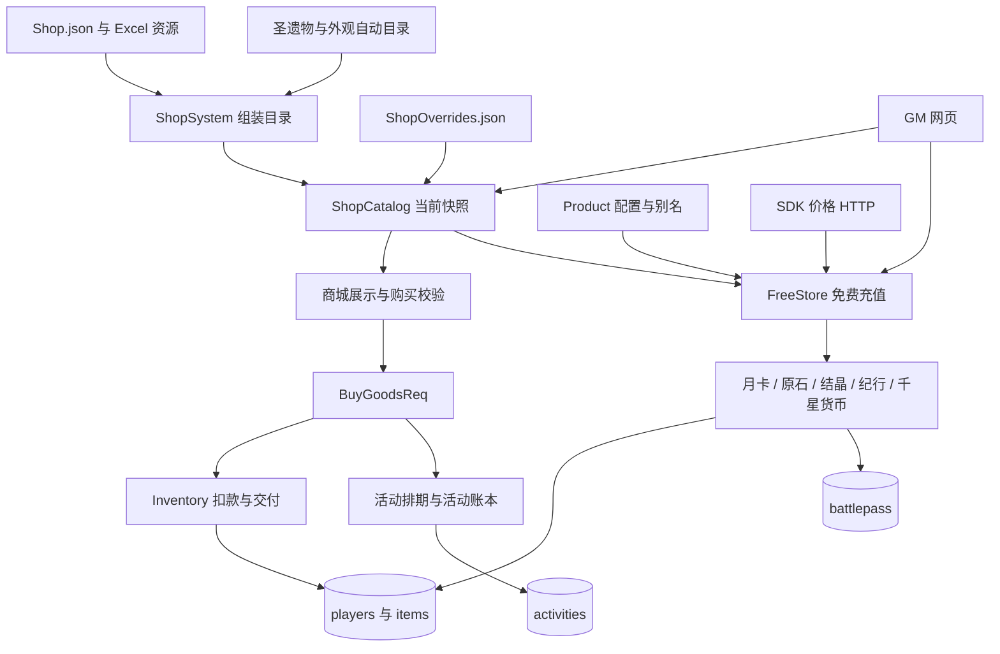
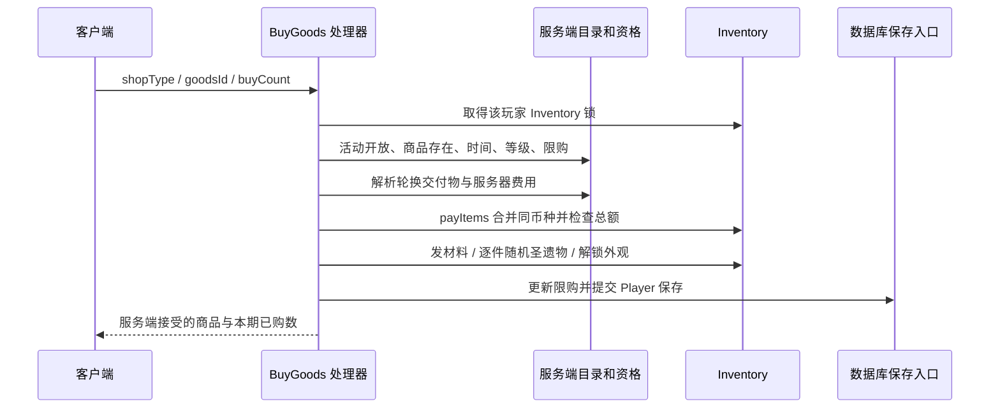
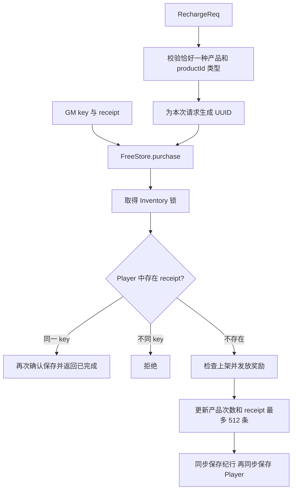

# 商城与充值系统接手指南

本项目把普通商品兑换、活动代币兑换、免费充值商品和外观解锁放在相邻入口中，但它们不是同一种交易。**当前充值由 `FreeStore` 免费发放，价格固定为 0，没有真实支付网关、支付订单、支付回调验签或退款结算链路。**普通商店仍按服务端商品配置消耗游戏货币或材料。

核对日期：2026-10-22。源码基线：`519eb03386d19c4a62ecd74d4a83ac02427e0ba0`，LunaGC 7.1.0。本组文档依据该提交的生产代码、当前本地资源及现有回归；不是商业支付方案，也不是对全部客户端功能的验收声明。后续修改以当前源码为准，并更新受影响章节。

配套阅读：

- [数据、资源与持久化](SHOP_AND_RECHARGE_DATA.md)：商品编号、覆盖顺序、货币、月卡、纪行、购买记录和保存边界。
- [客户端协议与管理接口](SHOP_AND_RECHARGE_PROTOCOL.md)：包号、字段、SDK 价格初始化、GM HTTP 接口及客户端补丁。
- [运维、验证与后续工作](SHOP_AND_RECHARGE_OPERATIONS.md)：故障定位、只读检查、测试、风险清单和 AI 接手模板。
- [账号与存档系统](ACCOUNT_AND_SAVE_SYSTEM.md)：账号 ID、玩家 UID、数据库路由、保存保护与备份前提。

建议第一次接手按本页 → 数据 → 协议 → 运维阅读；处理具体故障时用运维表定位到对应源码。

## 必须先掌握的事实

1. `shopType` 是商店编号；`goodsId` 是兑换商品编号；`itemId` 是交付物种类。充值另用字符串 `productId` 和规范化 `key`，不能互换。
2. `BuyGoodsReq` 只用客户端提供的商店、商品编号、购买份数定位服务端目录；客户端价格和奖励不是权威数据。
3. `RechargeReq` 直接进入免费发放。SDK 价格表仅供显示和商品初始化，不是支付凭证。
4. 普通商品费用来自 `ShopInfo`；`FreeStore` 的所有充值种类价格为 0。免费充值不代表所有商城商品免费。
5. 充值别名归并到同一个 key，首购次数按 key 保存。不同平台别名不是不同首购档位。
6. GM 可传入稳定 receipt 去重，但记录最多保留 512 条。游戏内每次充值生成新 UUID；GM 页面每次点击也生成新 UUID。
7. 月卡在上海时区 04:00 换日，不使用本机澳大利亚时区；离线错过的天数不会逐日补发。
8. 通用活动货币在 `activities.activityCoins`；熄星 109/110 在 `activities.detail` 的专用账本；原石、摩拉、结晶在 `players.properties`。三者不能互相替代。
9. `synchronized (Inventory)` 解决同一在线玩家的进程内交错；`saveGameSync` 确认一次保存。两者都不自动提供跨文档原子交易。
10. 原生商城显示还依赖正确协议、产品初始化通知、SDK 价格路由及客户端补丁；GM 发放成功不能证明原生结算窗口可用。
11. `resetShopLimit` 当前只把 `nextRefreshTime` 置 0，没有清空购买次数，不能按名字当成可靠的限购重置工具。
12. 本机使用 Windows 便携入口。纯文档无需重启；业务代码、配置或内置资源修改必须按 [AGENTS.md](../AGENTS.md) 更新运行构建。

## 系统地图

| 组件 | 职责 | 源码入口 |
| --- | --- | --- |
| `ShopSystem` | 加载目录、礼包内容、自动生成商品、产品表；发送价格目录通知 | [ShopSystem.java](../src/main/java/emu/grasscutter/game/shop/ShopSystem.java) |
| `ShopCatalog` | GM 覆盖、上下架、自定义编号、发布目录快照 | [ShopCatalog.java](../src/main/java/emu/grasscutter/game/shop/ShopCatalog.java) |
| `ShopInfo` / `ShopLimit` | 商品定义、轮换解析 / 玩家购买次数与刷新 | [ShopInfo.java](../src/main/java/emu/grasscutter/game/shop/ShopInfo.java)、[ShopLimit.java](../src/main/java/emu/grasscutter/game/shop/ShopLimit.java) |
| `PacketGetShopRsp` | 当前商品、价格、时间和购买次数的客户端视图 | [PacketGetShopRsp.java](../src/main/java/emu/grasscutter/server/packet/send/PacketGetShopRsp.java) |
| `HandlerBuyGoodsReq` | 普通购买总入口，分流活动与特殊交付 | [HandlerBuyGoodsReq.java](../src/main/java/emu/grasscutter/server/packet/recv/HandlerBuyGoodsReq.java) |
| `FreeStore` | 产品资源归一化、首购、receipt、免费发放和最终保存 | [FreeStore.java](../src/main/java/emu/grasscutter/game/shop/FreeStore.java) |
| `ActivityShop` / `AsterShop` | 活动资格、分页与复刻；熄星独立账本交易 | [ActivityShop.java](../src/main/java/emu/grasscutter/game/shop/ActivityShop.java)、[AsterShop.java](../src/main/java/emu/grasscutter/game/activity/aster/AsterShop.java) |
| `ActivityCurrencies` | 其他活动货币的归属、余额、确认收支 | [ActivityCurrencies.java](../src/main/java/emu/grasscutter/game/activity/ActivityCurrencies.java) |
| `Player` / `BattlePassManager` | 月卡与核心玩家字段 / 纪行档位、经验和奖励 | [Player.java](../src/main/java/emu/grasscutter/game/player/Player.java)、[BattlePassManager.java](../src/main/java/emu/grasscutter/game/battlepass/BattlePassManager.java) |
| `GmShop` / `AnnouncementsHandler` | 管理接口 / SDK 两版价格接口 | [GmShop.java](../src/main/java/emu/grasscutter/server/http/handlers/GmShop.java)、[AnnouncementsHandler.java](../src/main/java/emu/grasscutter/server/http/handlers/AnnouncementsHandler.java) |

## 普通商城从展示到购买

### 展示也会更新状态

`GetShopReq`、`GetShopBatchReq` 使用 `PacketGetShopRsp.buildShop`。该方法持玩家 Inventory 锁，因为展示会创建缺失限购、按周期刷新次数，并同步活动排期。每次构造单个商店只取一份目录快照，避免 GM 重载时把新旧商品混进同一商店响应。

构造时检查活动访问、商品销售时间及轮换交付物；等级范围发给客户端，购买入口再验证等级。已拥有的外观显示至少购买 1 次、限购 1。月卡、结晶不是 `goodsList` 中的普通行，而由 `FreeStore.addProducts` 填充独立产品列表。

单商店响应完成后保存 Player；批量入口对商店编号去重、最多接受 256 个，全部构造后保存一次。`buildShop` 本身不逐行保存。批量请求不是跨全部商店的目录事务快照。

### 普通购买顺序

具体规则：

- `buyCount <= 0` 拒绝；交付数使用 `Math.multiplyExact`。费用由 `payItems` 先合并重复 ID，再精确乘加并检查全部余额。
- 普通等级取冒险等阶；商店编号 100000–105000 使用千星等级属性。
- `buyLimit=0` 表示不限购；比较使用本期次数。刷新只清本期次数，不清总次数。
- 自动圣遗物先检查可用格数，随后每份独立随机。根据已接受商品行的物品 ID 交付，避免重载重新编号后串货。
- 外观先检查资源定义与所有权；千星服饰走 `BeyondCloset`。不能通过换 goodsId 或刷新限购再次购买已拥有外观。
- 不可存储的获得即使用外观执行道具动作；普通礼包优先作为物品入背包，留给玩家以后打开，避免礼包表缺失时购买直接消失。
- 普通入包失败会尝试返还成本；获得即使用完全失败也退款。部分动作成功时按整除后的单件费用退未交付部分，但最后仍按原购买份数记限购。这是当前行为，不是精确的订单补偿状态机。
- 成功响应使用已接受的商品，不在发货后重新查询目录。即使期间管理员关闭商店，也能描述这笔已接受购买。

源码的成功回包在普通异步保存完成前就可能发出。断电、保存失败及跨集合部分成功需要另行核对，不能把这条序列理解成 MongoDB 事务。

## 免费充值主链路

### 游戏入口与 GM 入口

游戏内 `RechargeReq` 必须恰好带一种支持产品：月卡、结晶、纪行或事象凝核。处理器仅取 productId 和产品分支，按别名映射找到资源商品，并检查种类一致。数量、奖金和价格不采用客户端值；纪行档位也取服务端产品定义。

GM 的 `/gm/api/store/purchase` 选择在线玩家 UID，传 key 和 receipt；原石直发产品没有原生 productId，仅在此类管理入口提供。

`find(key)` 在 receipt 检查前执行；资源已移除的 key 无法仅靠旧 receipt 返回成功。同 receipt、同 key 命中后不重新发奖，且不要求仍然上架。同 receipt、不同 key 被拒绝。receipt 作用域是单个玩家，不是全服唯一订单号。

**去重边界：**这能覆盖记录仍保留时携带原 receipt 的重复调用；不能保证跨崩溃恰好发放一次。发奖发生在记录 receipt 之前，月卡和纪行内部还会保存/通知，且纪行与 Player 分属集合。中途失败没有完整的充值发货预留可供自动恢复。

### 各产品的结果

| 种类 | 结果 | 限制 |
| --- | --- | --- |
| `card` | 增加月卡天数、立即发结晶、尝试领取当天原石 | 剩余天数加本次天数不能超资源上限；同日不重复日奖 |
| `crystals` | 结晶基础额 + 首购或后续额外奖励 | 每个 key 独立计首购；不是每个别名独立首购 |
| `primogems` | 直接发资源同档基础数量的原石 | GM 产品；无首购额外、无 SDK productId |
| `beyond_crystals` | 写事象凝核属性 10063 | 资源混淆字段独立解释，不能照搬结晶倍数 |
| `pass` | 解锁本期普通或高级纪行；高级奖励来自当前排期资源 | 升级款需先拥有普通纪行；已解锁档位拒绝重复 |

## 月卡和纪行

月卡入口是 `Player.rechargeMoonCard`。充值以“当前剩余天数 + 新天数”重新设置起点和时长；立即发结晶，然后尝试当天日奖。`getTodayMoonCard` 在登录、在线日更和每小时任务中调用。领取日使用 `GameCalendar.resetDay`，上海 04:00 为边界；领取标记保留最近成功日期。已过期会关闭状态；余额达到整数上限时不发日奖，也不标记已领取。道具动作 `ItemUseGainCardProduct` 使用固定默认参数，不经过 FreeStore 的产品次数与 receipt。

纪行档案在独立 `battlepass` 集合。当前排期取不超过服务端版本编号的最大资源排期，资源为空回退 2700；不是根据真实商业运营日历选赛季。第一次给旧档绑定排期保留进度，非零排期改变才清档位、经验、任务、领取记录等。本期显示结束时间仍有固定值，见数据文档。

普通/折扣普通档走 `unlockPaid(false)`；高级、升级和折扣高级走 `unlockPaid(true)`。高级档按排期的 `extraPaidRewardId` 和 `extraPaidAddPoint` 发物品、经验并设置 `extraPaidRewardTaken`。旧档如果已有合法付费轨奖励记录，`isPaid()` 仍承认其付费资格。

等级购买是另一条链路，消耗原石，不受充值价格 0 影响。当前每级 150 原石、最多 50 级；经验每级 1000，周上限 10000。领取等级奖励验证等级、所属轨、资源 rewardId、自选参数和已领取状态。Inventory → BattlePass 的锁顺序覆盖购买、解锁和领奖，但批量发货、资格和玩家余额的持久化仍有跨文档边界。

## 活动商店的两套账本

`ActivityShop` 用原资源 scheduleId 经 `ActivityHistory.json` 解析活动身份，再找当前复刻排期。必须存在该玩家、当前排期的活动进度。玩法截止后若总活动截止尚未到，可继续兑换。分页按活动第几天、上海 04:00 开启；提前预览不等于可购买。未支持的章节或任务条件不会被自动放行。

通用活动代币经 `Inventory.payItems` → `ActivityCurrencies.pay` → `ActivityCoinTransaction` 保存准备、余额变化和完成记录。它只确认同一活动文档的收支；后续商品交付和限购仍走普通链路。`activitycoins resume` 能恢复货币操作，不能据此承诺已补发商品。

熄星商店 1037 的 109/110 被专门分流到 `AsterShop`。先保存累计花费、本期商品次数和 `pendingShopPurchase`，再确认交付物/Player 保存，最后清预留并确认。中间不确定时保留预留并阻止继续兑换及相关活动奖励，等待人工对账。两币账本分开，旧预留缺 `currencyId` 按 109 兼容。普通背包里的同编号物品不能支付此商店。

## 设计边界与接手方向

已有实现解决了服务端价格权威、同玩家并发限购、目录重载串货、外观所有权、月卡换日和部分活动经济恢复。**尚无统一商城订单日志。**普通购买、免费充值、纪行奖励、通用活动扣币和熄星预留的保证不同，应按 [保存矩阵](SHOP_AND_RECHARGE_DATA.md#保存与故障边界)逐项理解。

扩展商品时优先复用现有资源和交付路径；涉及余额或发奖可靠性时先设计可持久化的交易身份与失败恢复，再修改入口。若未来明确要接真实支付，需要独立实现支付订单、服务端验签、金额/币种/SKU/玩家绑定、重复通知处理、可恢复发货及对账流程；不能只把当前价格从 0 改成非零。

当前源码可确认的缺口与尚待故障注入/实机验证的风险，统一列在[后续工作](SHOP_AND_RECHARGE_OPERATIONS.md#已确认边界与建议优先级)，本次文档工作没有静默修改这些业务规则。

## 历史证据与专题入口

详细实现背景见 [7.1 商城协议证据](protocol-store-7.1.md)、[历史外观目录](COSMETIC_STORE.md)、[商城并发回归](COMBAT_INVENTORY_SHOP_CONCURRENCY_2026-10-18.md)、[活动分页与排期](ACTIVITY_SHOPS_2026-10-11.md)、[熄星货币 109](ASTER_SHOP_2026-10-11.md)、[熄星货币 110](ASTER_BIG_SHOP_2026-10-12.md)和[通用活动币恢复](ACTIVITY_COIN_RECOVERY_2026-10-17.md)。这些文件保留各批次背景与证据；旧页中的“待实现”、部署方式、数量及哈希需结合后续批次和本次基线阅读，不能直接作为当前状态。
