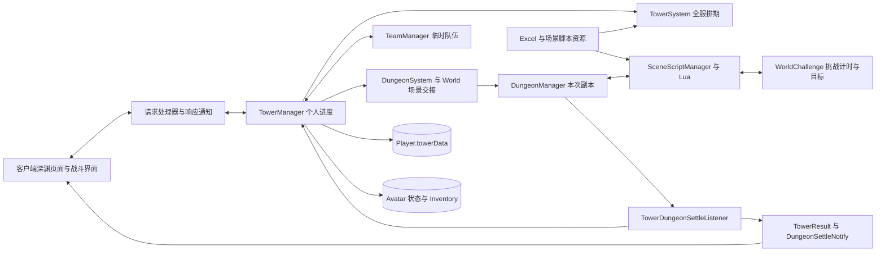
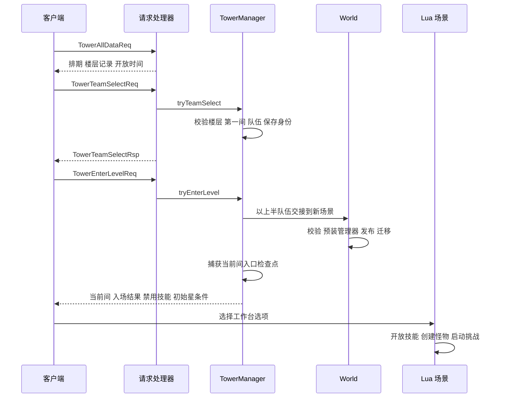
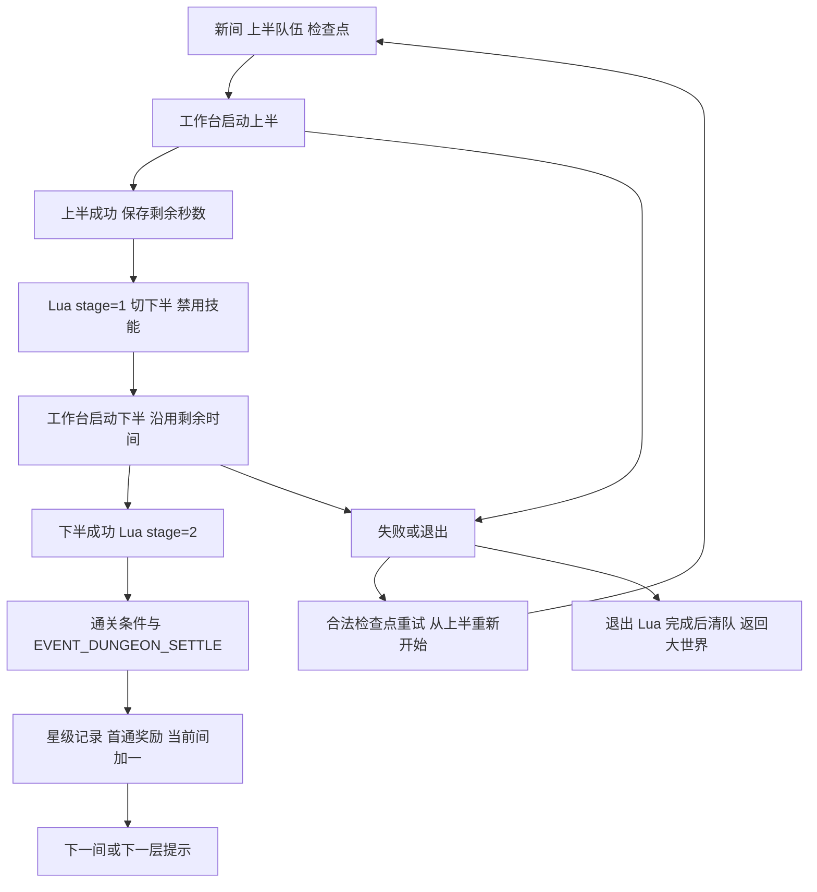

# 深境螺旋系统接手指南

> **2026-10-22 联调修复**：[原生入口与切队](SPIRAL_ABYSS_ENTRY_PROTOCOL_71.md)恢复全部数据请求、排期及层／间字段、下半场通知；深渊静态脚本组完整加载，避免实体距离保护丢失公共计时组。最新真实客户端验证范围以该文档为准。

> **开发增量**：本轮开发增量见[历史配置与管理工具](SPIRAL_ABYSS_MANAGEMENT.md)：新增 2022–2026 目录（90 条记录、26 期具备出怪脚本）、GM 第 8–12 层入场、不可变难度快照与出生点自定义；修复场景词缀初始化、召唤物清理、星记录通知和坏条件崩溃。下面的原接手快照中“只检查任意组文件”“固定 ID 绕过检查”“增量星记录固定值”等已由该增量覆盖。原生协议与官服实战验收限制仍然存在。

GS 的深境螺旋由客户端界面与协议、服务端玩家状态、资源表和 Lua 场景脚本共同组成。服务端已经实现选队、场景交接、上下半计时、重试检查点及异步结算；当前 7.1 客户端协议、星级领奖、祝福选择和周期重置仍有缺口。因此，“Java 逻辑通过测试”“资源包含某个排期”和“原生客户端可以完成整套深渊”必须分别判断。

本指南面向维护者和接手 AI，覆盖螺旋回廊及渊月螺旋，不把机关棋谭 `TowerDefense`、`TowerChallenge` 活动或其他名称含 Abyss 的玩法混入本系统。

## 基线与阅读导航

核对日期：2026-10-21。服务端为 LunaGC 7.1.0，源码基线 `7eb9f1229ff62bdb57df3db18fca1523e383c8ef`；资源子模块基线 `dac2a9d43332ef51879522cf39da2831b0ca0543`。本机客户端配置版本为 7.1.0，客户端二进制证据见[客户端与协议](SPIRAL_ABYSS_CLIENT_PROTOCOL.md)。这些结论描述本仓库，不代表官方线上版本规则。

| 资料 | 主要用途 |
| --- | --- |
| 本指南 | 整体架构、一次挑战的生命周期、关键不变量和源码入口 |
| [客户端与协议](SPIRAL_ABYSS_CLIENT_PROTOCOL.md) | 客户端实际类型、消息编号、字段、界面与服务端的衔接、兼容缺口 |
| [数据与资源](SPIRAL_ABYSS_DATA_AND_RESOURCES.md) | 排期算法、楼层与场景映射、Lua、星级、奖励、存档字典 |
| [排障与验证](SPIRAL_ABYSS_OPERATIONS.md) | 测试、症状定位、开发顺序、游戏内验收和交付 |
| [账号与存档](ACCOUNT_AND_SAVE_SYSTEM.md) | MongoDB 路由、异步保存、角色与物品的持久化边界 |

配套可机读证据：[资源审计](data/tower-resource-audit-2026-10-21.json)、[客户端符号摘录](data/tower-client-symbols-2026-10-21.json)、[本次测试汇总](data/tower-validation-2026-10-21.json)。完整客户端提取物留在本机忽略目录，不提交游戏文件或完整反编译产物。

## AI 接手先掌握的事实

1. 屏幕上的第 12 层不是 `floorId=12`。当前默认资源选择的第 12 层是 `floorId=1053`，第一间 `levelId=157`、`dungeonId=3106`、`sceneId=33746`。
2. `TowerData.currentLevel` 是零基间偏移；`getCurrentLevel()` 返回 1 至 3；`TowerData.currentLevelId` 是第一间 ID；`getCurrentLevelId()` 才是正在挑战的间 ID。
3. 每个玩家一个 `TowerManager`，每个游戏服一个 `TowerSystem`，每个副本场景一个 `DungeonManager`。全服排期、个人进度和单次战斗不能互相代替。
4. 当前选队按请求数组顺序决定上下半，不按 `tower_team_id` 排序。Lua 的队伍编号 1、2 转为 Java 临时队伍索引 0、1。
5. 长期保存以自有角色的 `avatarId` 重新绑定当前会话 GUID。旧 GUID 本身不能作为跨登录身份。
6. 首次入场、换间和重试都重建深渊场景，组状态采用场景内模式；相同 `sceneId` 不等于复用同一个 `Scene` 对象。
7. 上半成功事件的 `evt.param2` 是剩余秒数；普通挑战通常仍为已用秒数。下半不能再拿总时长减一次。
8. Lua 决定工作台、刷怪、`stage`、切队和技能开放时机；Java 决定有效状态、计时保护和记录结算。不要在 Java 开始挑战时抢先开启技能。
9. 重新登录回到副本返回地点；保存队伍和检查点不等于恢复怪物、计时和半场战斗。
10. `getRecordMap()` 有写内存副作用：默认补齐前八层满星并预记奖励已发。不要把它当成只读巡检接口。
11. 默认 `rotate=false`、`skipEntranceFloors=true`。源码筛选得到 62 个带组脚本的排期，默认选 62；资源表共有 126 个排期。
12. 当前负数消息编号、占位字段及未接入的领奖入口，会阻断或削弱原生界面流程。服务端测试会替换发包通道，不能检验真实客户端是否收到包。

## 系统组成

| 组件 | 职责 | 不应承担的替代职责 |
| --- | --- | --- |
| `TowerSystem` | 选择排期、列出楼层、计算下一层和显示时间 | 不保存玩家通关，不自动实现周期清档 |
| `TowerManager` | 选队、进入当前间、检查点、星级计算、首通记账 | 不自行定义每波怪物或客户端 UI |
| `TowerData` / `TowerLevelRecord` | 玩家内嵌存档与楼层记录 | 不是运行中的完整副本快照 |
| `TowerChamberState` | 保存并恢复当前间入口的角色生命、生命之契和能量 | 不保存所有 Ability modifier、怪物或冷却剩余秒数 |
| `TeamManager` | 校验临时队伍、选择上／下半、更新实体与恢复常规队伍 | 不决定排期、星数或领奖资格 |
| `DungeonSystem` / `World` | 入场、同 ID 新场景、重试、退出、单人准入及返回地点 | 不能只调用普通传送后再补装深渊管理器 |
| `SceneScriptManager` / `ScriptLib` | 运行脚本、组变量、suite、工作台、怪潮及 Java 桥接 | 不能绕过场景身份保护结算旧战斗 |
| `WorldChallenge` | 目标进度、起止时刻、成功／失败事件 | 单个半场完成并不自动等于整间完成 |
| `TowerDungeonSettleListener` | 成功时更新星级、推进间数，构建结果 | 失败和退出不增加通关星数 |

## 从打开页面到进入第一间

下面是已有实现意图和方法调用顺序；真实网络可达性按[协议状态表](SPIRAL_ABYSS_CLIENT_PROTOCOL.md#消息实现与传输状态)判断。

### 全量数据和解锁显示

`HandlerTowerAllDataReq` 构建 `PacketTowerAllDataRsp`，后者读取全部 `recordMap`，同时发送传统 `passed_level_map` 与按条件序号表示的 `passed_level_record_list`。当前记录固定 `is_empty=true`，并未完整回传已保存队伍、当前半场和祝福。

`canEnterScheduleFloor()` 只看最后一个入口层是否至少六星。默认补满前八层后，还会创建第一个排期层的空记录；这用于支持客户端的开放显示。选队入口本身没有根据前层星数或当前排期成员资格再做完整准入校验，不能把 UI 锁定当成服务端授权。

### 选队和失败保护

`tryTeamSelect` 持有 `player.getSceneTransferLock()`，先核对楼层、`teamNum`、第一间，再调用 `trySetupTemporaryTeam`。后者要求每队非空、人数不超过当前队伍上限、GUID 能解析为该玩家角色、队内和跨队不重复，并拒绝相关 TPS 临时角色上下文。全部通过后才替换临时队伍。

成功后保存楼层、零基间偏移 0、第一间 ID、完整双队 GUID 和稳定角色 ID，清空旧检查点和上下半计时缓存，首次记录 `entryScene`，最后调用 `player.save()`。失败返回 `RET_FAIL`，不会把失败的楼层与队伍写成新的选择。

`player.save()` 是异步保存入口，不是这一刻已完成数据库确认；本系统未为整个选队与进本流程建立数据库事务。

### 场景交接

`tryEnterLevel` 先恢复临时队伍并确认关卡／副本存在，再通过 `enterSceneWithTemporaryTeam(0, callback)` 预选上半和第一个角色槽位。这个步骤不会提前改写旧场景实体。

回调依次经过 `DungeonSystem.handoffDungeon`、`World.handoffTowerDungeonScene`。只允许当前世界的单人宿主，从正常大世界或合法深渊场景交接；拒绝多人、身份失配、资源错误、已销毁场景和被其他玩家占用的目标场景。

新场景先带上 `DungeonManager`、`towerDungeon=true`、返程信息和结算监听器，才发布到世界并迁移玩家。传送事件可以取消；事件之后还会重查场景、资源和管理器身份。失败且玩家仍在原场景时恢复原队伍索引和角色槽位；这不是任意迁移异常都可回滚的事务保证。

成功后才发送入场成功、当前间和初始星条件，禁用技能并捕获检查点。资源工作台开始对应半场时再通过 `SetIsAllowUseSkill(1)` 开放技能。

## 上下半场与结算

双队层的一间通常经历 `stage=0 → 1 → 2`：上半准备／进行、下半准备／进行、整间完成。这个变量属于具体 Lua 状态组，不是 `TowerData` 字段；不同场景的状态组编号不同。

### 计时如何传递

`WorldChallenge.done()` 固定本半场 `finishedTime`，计时深渊成功事件传出 `max(0, timeLimit-finishedTime)`。在 Lua 切队前，`recordHalfTime` 绑定场景对象、管理器对象、楼层、当前间、稳定队伍、上半挑战对象和剩余秒数。

下半 `ActiveChallenge` 调用经过 `resolveHalfTime`：只接受同一上下文、同一上半挑战遗留的缓存。零剩余转为拒绝启动的哨兵值，避免 `timeLimit=0` 被通用挑战解释为不限时。这个修正仅覆盖代码明确列出的计时挑战类型；不能外推到所有脚本 API。

例如一间总时长 600 秒，上半耗时 120 秒，则下半预算 480 秒；下半再耗时 180 秒，整间剩余 300 秒。若三个阈值为 180、300、420 秒，按当前 `>=` 比较得到两星。换队等待未作为第二次挑战的战斗用时计入，具体客户端倒计时显示仍需验收。

### 为什么必须先执行 Lua 再结算

`WorldChallenge.done()` 先投递 `EVENT_CHALLENGE_SUCCESS`，等待脚本事件的完成回调，再触发 `DUNGEON_COND_FINISH_CHALLENGE` 和挑战完成触发器。`DungeonManager` 随后先完成 `EVENT_DUNGEON_SETTLE`，再更新完成进度、执行结算监听器并广播 `DungeonSettleNotify`。

若反过来执行，Lua 尚未将 `stage` 从 1 改为 2，Java 就可能把下半结果当成上半，或在记录时丢失正确星数。当前使用异步回调延续，不在脚本工作线程中等待同队列的另一个任务；相关单工作线程场景已有回归测试。

回调必须仍匹配同一个玩家、世界、场景对象、管理器、挑战、挑战启动序号、加载组、楼层、当前间和队伍。`towerLifecycle`、`towerCompletionGeneration`、`pendingTowerEnd`、`towerEndFinalized` 用于阻止旧场景迟到事件、重复成功及退出后再次发奖。仅比对 `sceneId` 不足以保护同编号重建。

`TowerDungeonSettleListener` 对成功结果额外检查已加载组的 `stage==1`，此时不记录整间完成。成功结算后按最高星更新记录并推进间数；失败／退出构建普通失败结果，不添加通关星数。最终一层不创建 floor 0 记录。

### 星级和结果消息

时间条件使用剩余时间，守护条件使用守护实体百分比；已成功结束的挑战使用冻结的 `finishedTime`，不会因异步脚本等待继续掉星。进行中 `onTick()` 在可达星级下降时逐星发失败条件通知。

`TowerResult` 嵌在 `DungeonSettleNotify.tower_level_end_notify` 中，包含本次星条件、首通奖励展示和继续状态：0 不可继续、1 可进下一间、2 可进下一层。它并未走单独的 `TowerLevelEndNotify` 发包入口。更详细的奖励边界见[数据与资源](SPIRAL_ABYSS_DATA_AND_RESOURCES.md#奖励链路与一致性边界)。

## 重试 退出与重登

### 当前间重试

`tryRestartDungeon` 对深渊调用 `tryRestartChamber`。必须有匹配当前楼层、间、队伍、角色归属、技能库和能量类型的有效检查点；只有 `towerDungeon=true` 不够。重试重建新场景并从上半开始，保持当前间编号及返程信息。

成功重试恢复双队全部角色入口 HP、生命之契、元素或特殊能量，并钳制到当前有效上限；更新当前实体、角色保存与生命／战斗属性通知。接着重置选中角色技能冷却／充能及其共享冷却组，清空旧计时标志，重新发送禁用技能、当前间和初始星条件。未选角色和无关共享冷却不应被清除。

检查点捕获是同一楼层、间、队伍组合的幂等操作。上半开始、下半开始时的再次捕获不能覆盖入口状态，否则失败后会恢复成受伤后的状态。

这不是原生客户端所有“重开”按钮都已接入：`TowerEnterLevelReq._is_restart_floor` 当前被忽略；普通 `DungeonRestartReq` 有领域副本专用保护，会拒绝深渊；死亡选择 `DIE_OPT_REPLAY` 才调用现有深渊重试链。按钮映射需按真实包验证。

### 退出

`exitDungeon` 为深渊安排带回调的 `quitDungeon(exit)`。Lua 退出结算完成后才清临时队伍、清 `entryScene`、取消深渊标记并安排约 200ms 后返程。重复退出只应安排一次传送。没有挑战对象但已经进入场景的状态也允许退出／失败。

退出使用 `prevScene`、`prevScenePoint` 找返回传送点，缺失时采用默认大世界回退。清入口不等于清 `recordMap`、队伍历史或奖励标记。

### 断线和再次登录

`Player.recoverDungeonLoginLocation()` 把保存于副本的角色恢复到 `DungeonReturnLocation` 解析出的安全大世界位置。`TowerManager`、当前挑战和半场计时是临时对象，不从 MongoDB 恢复战斗。

后续选队／进本可以用 `abyssAvatarIds` 绑定新 GUID 并恢复临时队伍；旧数据仅有 GUID 时，只允许从能核对一致的有效现场临时队伍迁移。不能拿一串失效 GUID 猜成另一个角色。标准全量响应仍把当前挑战记录标为空，所以不能承诺客户端提供完整“继续上次挑战”。

## 当前完成度与接手顺序

| 范围 | 当前结论 |
| --- | --- |
| 选队校验、稳定身份、场景交接、重试与异步结算 | 有明确实现及服务端回归 |
| 当前默认排期的资源链 | 可解析，36 间满足当前脚本存在性检查；不是逐间实战认证 |
| 7.1 原生页面与消息 | 有类型证据，但部分 CmdId 和字段未恢复，不能宣布全链路可用 |
| 星级奖励、祝福选择、周期重置 | 当前实现不完整；见配套文档逐项证据 |
| 首通奖励 | 有发放入口和内存去重标记，缺少跨存档原子性与容量确认闭环 |
| 完整原生客户端验收 | 本次未执行；动画、UI、怪潮、守护和奖励到账仍需场景化验收 |

优先修通“真实请求到达 → 实际回包送达 → 字段被客户端读取”，再验证 Lua 战斗；随后补齐领奖与周期持久化。先修 Java 数值而不核对丢弃的网络包，可能无法改变用户看到的症状。

## 源码导航

| 问题 | 首选入口 |
| --- | --- |
| 现在开放哪一期 | [TowerSystem](../src/main/java/emu/grasscutter/game/tower/TowerSystem.java)、[TowerOptions](../src/main/java/emu/grasscutter/config/ConfigContainer.java) |
| 个人深渊流程 | [TowerManager](../src/main/java/emu/grasscutter/game/tower/TowerManager.java) |
| 个人持久字段 | [TowerData](../src/main/java/emu/grasscutter/game/tower/TowerData.java)、[TowerLevelRecord](../src/main/java/emu/grasscutter/game/tower/TowerLevelRecord.java)、[TowerChamberState](../src/main/java/emu/grasscutter/game/tower/TowerChamberState.java) |
| 临时队伍与实体 | [TeamManager](../src/main/java/emu/grasscutter/game/player/TeamManager.java) |
| 进本、重试和退出 | [DungeonSystem](../src/main/java/emu/grasscutter/game/dungeons/DungeonSystem.java)、[World](../src/main/java/emu/grasscutter/game/world/World.java) |
| 异步结算与失效保护 | [DungeonManager](../src/main/java/emu/grasscutter/game/dungeons/DungeonManager.java)、[WorldChallenge](../src/main/java/emu/grasscutter/game/dungeons/challenge/WorldChallenge.java) |
| 结果与发奖 | [TowerDungeonSettleListener](../src/main/java/emu/grasscutter/game/dungeons/TowerDungeonSettleListener.java)、[TowerResult](../src/main/java/emu/grasscutter/game/dungeons/dungeon_results/TowerResult.java) |
| Lua 入口 | [ScriptLib](../src/main/java/emu/grasscutter/scripts/ScriptLib.java)、[SceneScriptManager](../src/main/java/emu/grasscutter/scripts/SceneScriptManager.java) |
| 怪物数值 | [EntityMonster](../src/main/java/emu/grasscutter/game/entity/EntityMonster.java)、`DungeonManager.getLevelForMonster` |
| 网络真正发出／注册 | [GameSession](../src/main/java/emu/grasscutter/server/game/GameSession.java)、[GameServerPacketHandler](../src/main/java/emu/grasscutter/server/game/GameServerPacketHandler.java) |

后续修改以当前代码为准；同步更新相应章节、审计快照及测试记录。历史专题的“仍未完成”只代表当批状态，不能覆盖后续实现。
